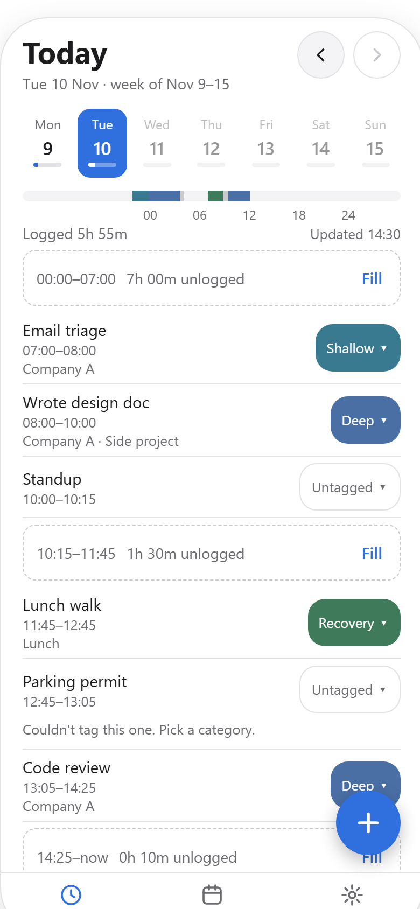
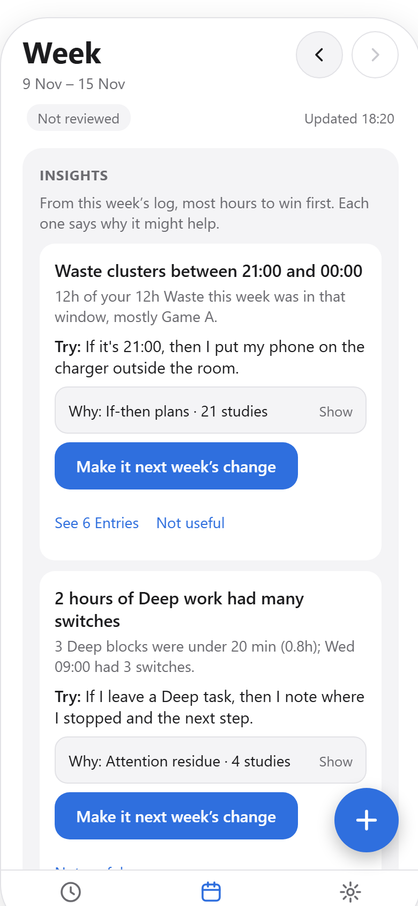
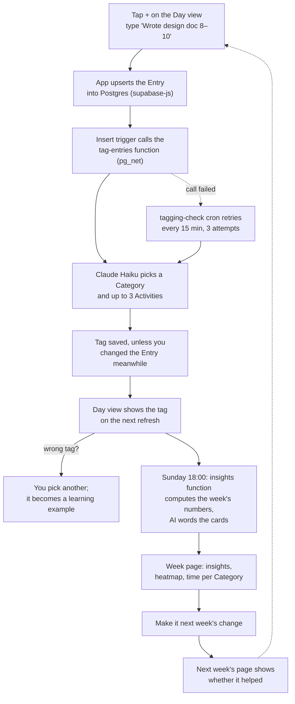
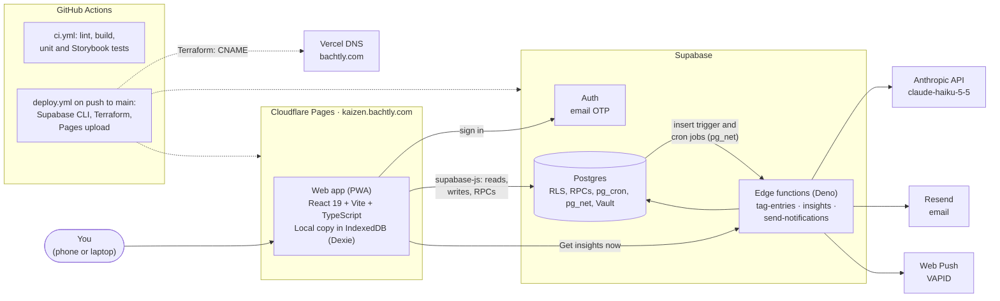
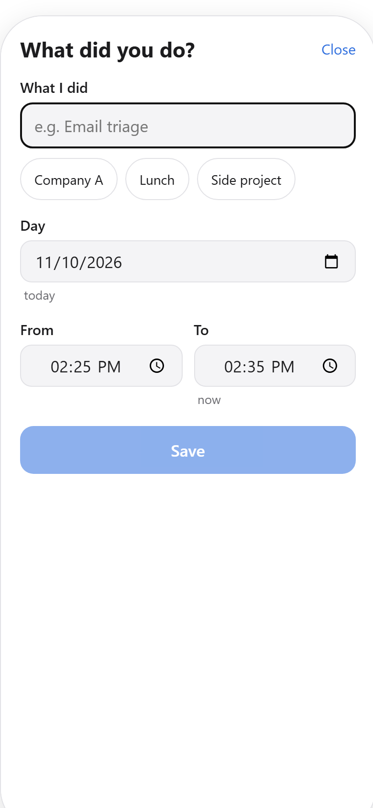
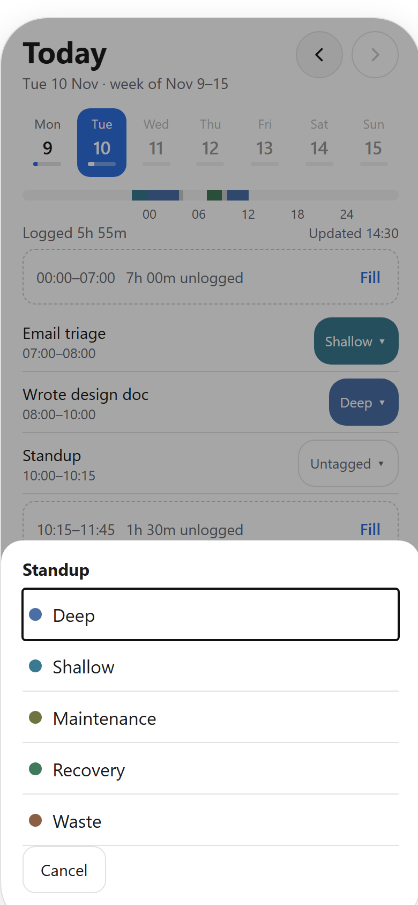
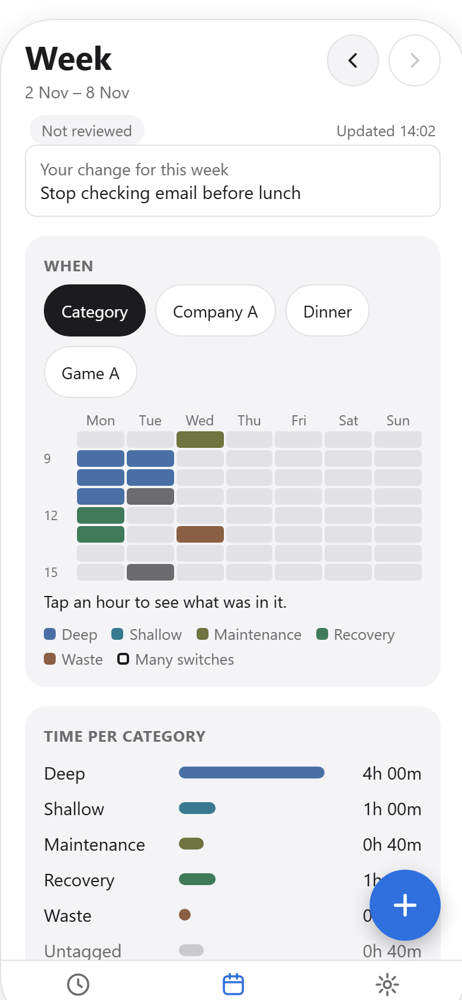
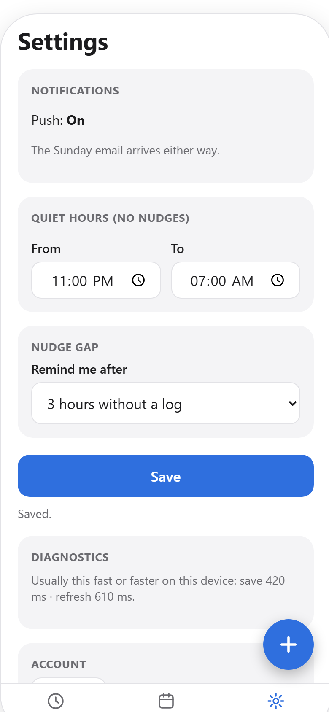
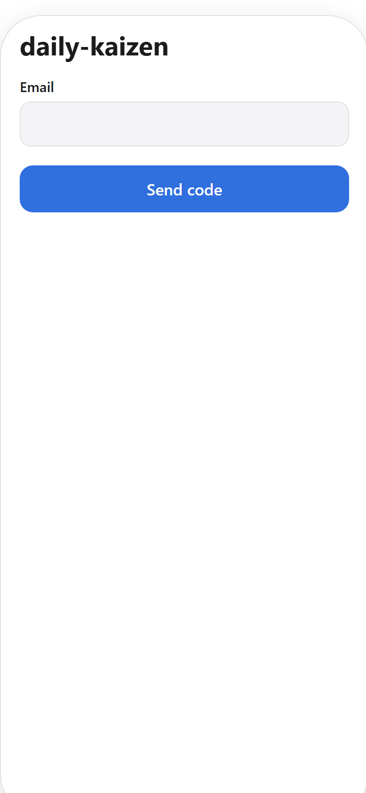

# daily-kaizen

**Log your day in plain words. AI tags each entry. A weekly review shows where your time goes and whether your changes cut the waste.**

[](https://github.com/bachtly/daily-kaizen/actions/workflows/ci.yml)
[](https://github.com/bachtly/daily-kaizen/actions/workflows/deploy.yml)
[](https://kaizen.bachtly.com)
[](https://github.com/bachtly/daily-kaizen/commits/main)

<p align="center">
  
  &nbsp;
  
</p>

## What and why

daily-kaizen is a phone-first web app (installable PWA) for one person who wants an honest picture of their time. You type a few words after the fact, like "scrolled reddit 20m" or "lunch 12–13". An AI labels each entry with a **Category** (Deep, Shallow, Maintenance, Waste, Recovery) and the **Activities** it was for. Each week the app turns your log into insights, you pick one small change, and the next week shows whether it helped. That is the kaizen loop.

It is not a screen tracker, a timesheet or a to-do list. It records what happened, roughly.

## Features

| Feature | What you get |
|---|---|
| **Fast logging** | One text field, start and end time. Backfill any past day. **Fill** turns an Unlogged gap into an Entry. |
| **AI tagging** | Each Entry gets a Category and up to 3 Activities from Claude. Change any tag by hand; the AI learns from your last 20 corrections. |
| **Suggested categories** | The AI can propose a new Category. You approve or reject it on the Week page. |
| **Week page** | Time per Category and per Activity, weekly targets, a days × hours heatmap and an 8-week trend. |
| **Insights** | Every Sunday: findings from your own log, an if-then suggestion and one checked source. Or ask for them mid-week. |
| **Weekly change** | Pick one insight as next week's experiment. The next week shows the result ("Usual 5h–7h → 2h · Helped"). |
| **Reminders** | A push when you forget to log, a Sunday review reminder by email and push, and quiet hours. |
| **Works offline** | A read-only Local copy (IndexedDB) keeps the Day view and Week page readable without a connection. |
| **Passwordless sign-in** | Email plus a 6-digit code. Add to Home Screen on iPhone or Android. |

Each feature has a short doc in [`docs/features/`](docs/README.md).

## Quickstart

See the real screens with demo data. No accounts or secrets needed (Node LTS):

```sh
git clone https://github.com/bachtly/daily-kaizen.git
cd daily-kaizen/app
npm ci
npm run storybook        # http://localhost:6006
```

To run the full app, copy `app/.env.example` to `app/.env`, fill in the URL and anon key of a Supabase project with [`supabase/migrations/`](supabase/migrations) applied, then run `npm run dev`. The checks run before every commit:

```sh
npm --prefix app run lint && npm --prefix app run build && npm --prefix app test
```

## How it works

The main journey: log an Entry, let the AI tag it, review the week, pick one change.



## Architecture



| Layer | Stack |
|---|---|
| Client | React 19, React Router, Vite, TypeScript, Dexie (IndexedDB), service worker for push and install |
| Backend | Supabase: Postgres with row-level security, Auth (email OTP), Deno edge functions |
| Jobs | `pg_cron`: tagging retry every 15 min, notifications every 5 min, insights hourly (per user time zone) |
| AI | Anthropic `claude-haiku-5-5` for tagging and insight wording; code computes every number |
| Messaging | Web Push (VAPID) and Resend email |
| Hosting | Cloudflare Pages (Direct Upload), DNS at Vercel, both managed by Terraform in [`infra/`](infra) |
| CI/CD | GitHub Actions: [`ci.yml`](.github/workflows/ci.yml) on every PR, [`deploy.yml`](.github/workflows/deploy.yml) on push to `main` |
| Tests | Vitest (unit and Storybook browser tests with axe), Deno tests for functions, `supabase test db` for SQL |

Deploy details and secrets: [`infra/README.md`](infra/README.md).

<details>
<summary><b>More screenshots</b></summary>
<br>

All screens are the real React components rendered in Storybook with demo data, at a 390 × 844 phone viewport.

| Log sheet | Change a tag | Week page |
|---|---|---|
|  |  |  |

| Settings | Sign in |
|---|---|
|  |  |

</details>

## Project layout

| Path | What's there |
|---|---|
| [`app/`](app) | The web app and its Storybook stories |
| [`supabase/`](supabase) | Migrations, edge functions, DB tests, email templates |
| [`infra/`](infra) | Terraform for Pages and DNS, plus the deploy guide |
| [`docs/features/`](docs/README.md) | What each feature does today, its rules and decisions |
| [`docs/design/`](docs/design/README.md) | Frozen archive of the approved MVP design |

## Why build it

No open-source tool covered the whole loop. Trackers like [TimeTagger](https://github.com/almarklein/timetagger), [Traggo](https://github.com/traggo/server), [Simple Time Tracker](https://github.com/Razeeman/Android-SimpleTimeTracker), [Super Productivity](https://github.com/johannesjo/super-productivity) and [Kimai](https://github.com/kimai/kimai) record time well. None tag free text with AI or run a weekly review of wasted time.

## Contributing

This is a personal project built for one user, but issues and small PRs are welcome. Keep a PR to one change, run the check command above, and update the matching file in `docs/features/` when behaviour changes. [`CLAUDE.md`](CLAUDE.md) lists the repo's rules.

## License

No license has been chosen yet, so all rights are reserved by default.
