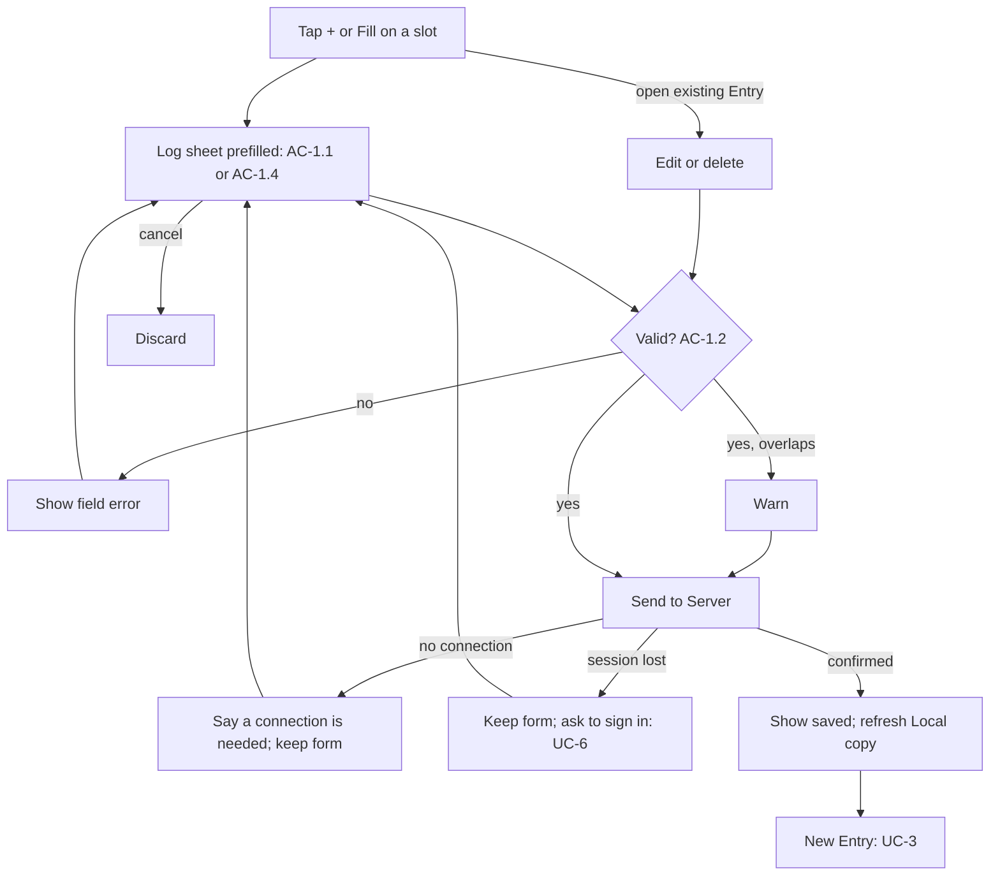
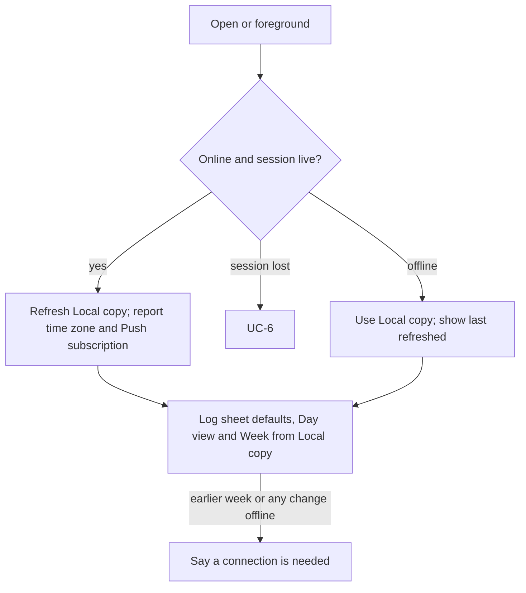
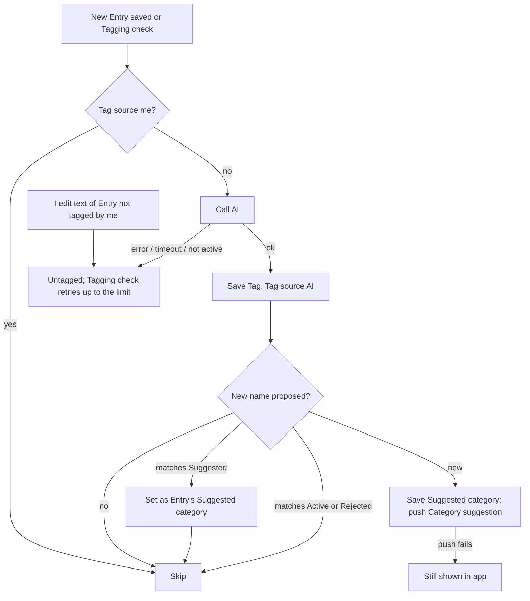
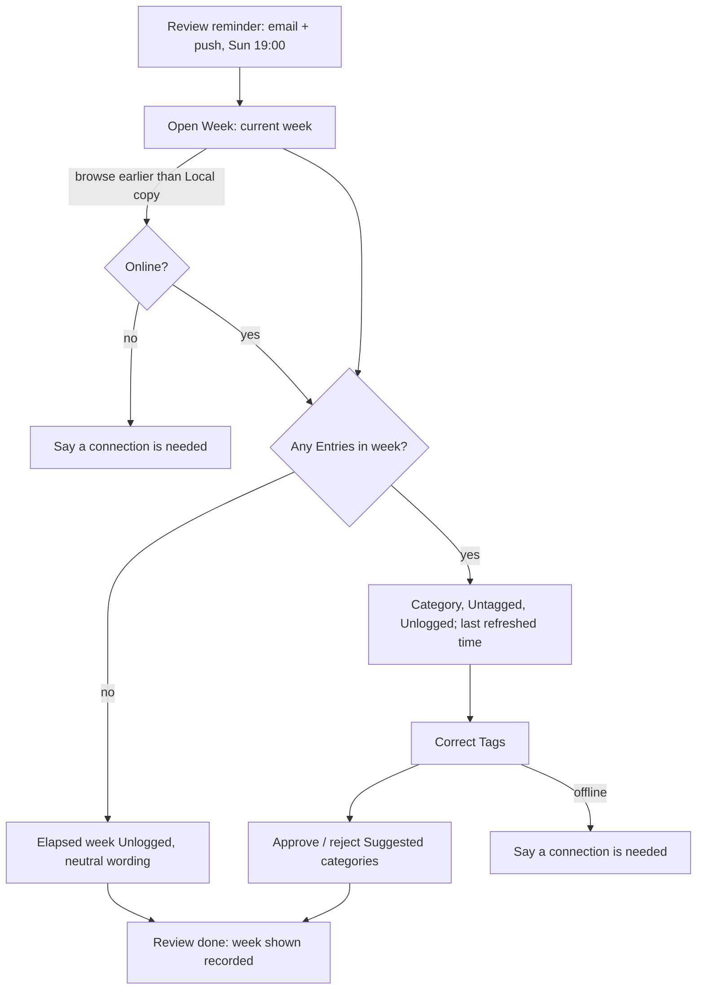
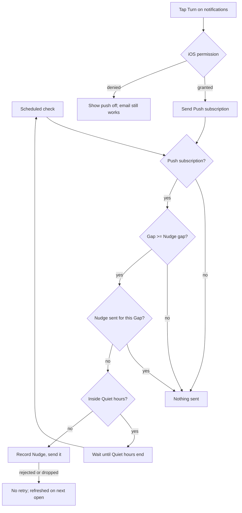
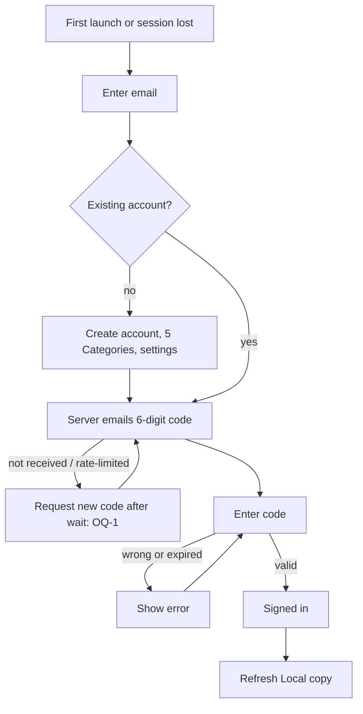

# daily-kaizen MVP: requirements

Direction: [D3](03-data-model.md#decisions) (every write needs a connection; the phone keeps a read-only Local copy)
and [D2](#decisions) (Tagging check). Sources: [`docs/mvp-design.md`](../../mvp-design.md) (`mvp-design §…`), [`README.md`](../../../README.md)
§Categories, and [01-research.md](01-research.md) "Our system today" items 1 to 8 (`R1` to `R8`). Terms follow the
[00-brief.md](00-brief.md) Glossary. (judgement) marks points not in an approved doc. Each rule is stated once, in its
AC; use cases refer to it.

## Actors

| Actor | Description | Permissions |
|---|---|---|
| Me | A user (me or anyone who signs up), on an iPhone (iOS 18.4+) home-screen web app, writing in English (brief Constraints) | Only my own rows (AC-7.2) |
| Server | Supabase database, Edge Functions and pg_cron jobs | Service role; jobs call functions with a shared secret |
| AI | Claude Haiku 5.5, called only by the Server to pick Tags and Activities | Sees an Entry's text, the Active Categories and the Active Activity names |

## Use cases

### UC-1 · Log, edit or delete an entry
Me · I tap the floating + (any screen), or Fill on an Unlogged slot of any day · Signed in on this phone.
Main flow: 1. The Log sheet opens prefilled (AC-1.1, or AC-1.4 for Fill). 2. I type the text, adjusting times if backfilling. 3. I save; the Server saves it (AC-1.2, AC-2.1). 4. UC-3 runs for a new Entry.
Alternate flows: 2a. Backfill: I open a past day, tap Fill on an Unlogged slot, and log it one Entry at a time (AC-1.4). 2b. I open an existing Entry and edit or delete it (AC-1.3). 2c. I cancel → nothing is saved.
Exceptions: 3a. Invalid or overlapping → AC-1.2. 3b. No connection or login session lost → AC-2.2; a lost session also starts UC-6.
Postconditions: the Entry or change is on the Server and in the Local copy, or nothing changed and the form still holds my text.

### UC-2 · Open the app
App · app opens or returns to the foreground · Signed in.
Main flow: 1. If online, the app refreshes the Local copy and reports the time zone and push subscription (AC-2.3). 2. The Day view (today) and the Week page read from the Local copy (AC-2.4).
Exceptions: 1a. Offline → the Local copy as last refreshed, with that time shown. 1b. Session lost → UC-6. 1c. iOS cleared browser storage → the session is gone too, so I sign in (UC-6) first; no Local copy until then; nothing saved is lost (G3).
Postconditions: the Local copy holds this week and last week, as of the time shown.

### UC-3 · Tag an entry
Server · a new Entry is saved, or the Tagging check finds an Untagged entry · Tag source is not me.
Main flow: 1. The Server sends the text, Active Categories and Active Activity names to the AI. 2. The AI picks a Category and may propose a new one; it also names the Activity (AC-8.1). 3. The Server saves the Tag (AC-3.1), handles any proposal (AC-3.4) and saves the Activity.
Exceptions: 1a. AI call fails, times out or returns a Category that isn't active (judgement) → Untagged, retried (AC-3.2). 3a. I set the Tag meanwhile → mine is kept (AC-3.3). 3b. Push off or failing → the Suggested category still shows in the app.
Postconditions: the Entry has exactly one Tag, or is Untagged and will be retried.

### UC-4 · Weekly review
Me · the Review reminder, or I open the Week tab · Signed in.
Main flow: 1. The page shows the current week (AC-5.1); I may browse to an earlier week. 2. I correct wrong Tags (AC-4.1). 3. I approve or reject Suggested categories (AC-4.2, AC-4.3). 4. I tap "Review done" (AC-5.3).
Exceptions: 1a. No Entries in the week → all Unlogged, neutral wording (R8). 1b. Offline → the Local copy with its refresh time; weeks older than it, and every change, need a connection (AC-2.2, AC-2.4). 1c. Push not delivered (R4) → the email still arrives.
Postconditions: corrected Tags have Tag source me; approved Categories are active; the week shown has a Review done record.

### UC-5 · Nudge
Server · scheduled check · a Push subscription exists.
Main flow: 1. The job finds a Gap that reached my Nudge gap (default 3 hours). 2. The Server sends one Nudge (AC-6.1).
Exceptions: 2a. Gap reached inside Quiet hours → Nudge at their end, about 07:00; accepted (user decision). 2b. Push endpoint rejects or drops → no retry; subscription refreshed on next open (R4).
Postconditions: at most one Nudge per Gap, recorded.

### UC-6 · Sign in
Me · first launch or session lost.
Main flow: 1. I enter my email. 2. The Server emails a 6-digit code (Resend SMTP, R6). 3. I enter it (AC-7.1). 4. UC-2 runs.
Exceptions: 1a. New email → an account is created and seeded (AC-7.2). 2a. Email not received or rate-limited → I request a new code after a wait (OQ-1). 3a. Wrong or expired code → error, retry.
Postconditions: the app holds a login session.

## User stories

### US-1 · As me, I want to log and fix entries in seconds, so that logging stays a habit (G1, G2)
Logging burden (R8) is owned by the ui stage.
- AC-1.1 When the Log sheet opens from the floating +, the app shall prefill:
  - start with the latest end time among Entries in the Local copy, or the start of today if there is none;
  - end with the current time.
- AC-1.2 When I save an Entry, the app shall:
  - refuse, showing the wrong field, if the text is empty, end is not after start, or end is over 5 minutes after now (5 minutes is judgement);
  - warn, and still save, if it overlaps another Entry;
  - send it with the phone's IANA time zone and, on create only, the time the form opened, which NFR-1 uses.
- AC-1.3 When I edit or delete an Entry, the app shall apply the AC-1.2 checks to an edit, without sending a form-open time (NFR-1 measures creates only); a delete removes the Entry for good (judgement).
- AC-1.4 When I open a day on the Day view (any day; days older than the Local copy are fetched and need a connection), the app shall list its Entries in time order with its Unlogged slots between them. When I tap Fill on a slot, the Log sheet shall open with start and end set to the slot, on that day; the Log sheet from the floating + shall let me pick any past day, starting on the day shown; after a confirmed save, what is left of the slot stays as a slot (#46).

### US-2 · As me, I want every saved change to be on the Server, and this week and last week readable offline, so that nothing saved is lost and the app stays useful without a connection (G3, G1, G2)
- AC-2.1 When I save any change (Entry, Tag, Suggested category decision, Review done or setting), the app shall show it as done only after the Server confirms it (D3).
- AC-2.2 If a save fails or its result is unknown (no connection, timeout or lost login session), then the app shall say so and keep what I typed in the form while the app stays open (judgement), and saving again shall be safe: a repeated create never makes a duplicate Entry (mechanism: api stage); a lost session also asks me to sign in.
- AC-2.3 When the app opens or returns to the foreground online, or the Server confirms a change, the app shall:
  - refresh the Local copy: my Entries that end after the previous Monday 00:00 (so sleep crossing into Monday is included), Categories and settings (judgement);
  - on open or foreground only, report the phone's IANA time zone, which scheduled jobs then use, and send the current Push subscription if push permission is granted (R4).
- AC-2.4 The app shall read the Log sheet defaults, the Day view and the Week page for the current and previous week from the Local copy, never change it except by a refresh, and show on the Day view and Week page when it was last refreshed; earlier weeks need a connection.

### US-3 · As me, I want Entries tagged without my effort, so that the Weekly review needs no categorising (G1, G2)
Starting Categories: Deep, Shallow, Maintenance, Waste, Recovery (README §Categories); their descriptions are in [03-data-model.md](03-data-model.md).
- AC-3.1 When a new Entry is saved, or the Tagging check picks up an Untagged entry, the Server shall ask the AI to pick one Active Category and save it as the Tag with Tag source AI.
- AC-3.2 If an Entry is Untagged, because tagging failed or timed out, or because I changed the text of an Entry whose Tag source isn't me (which clears its Tag and retry count), then the Tagging check shall retry it every 15 minutes, up to a limit (OQ-3, D2). After the limit, the Day view shall show it as Untagged with a "couldn't tag" note, and I tag it by hand (AC-4.1). Repeated tagging shall leave one Tag and at most one Suggested category and one Category suggestion.
- AC-3.3 If an Entry's Tag source is me, then the Server shall never change that Tag, even if I edit its text.
- AC-3.4 When the AI proposes a new category, the Server shall keep the Entry in the best Active Category and:
  - if the name matches a Suggested category, set it as the Entry's Suggested category and send nothing;
  - if the name matches an Active Category or a Rejected category, create nothing (judgement);
  - otherwise save a Suggested category, set it as the Entry's Suggested category, and send a Category suggestion.

### US-4 · As me, I want to fix Tags and decide on Suggested categories, so that the Weekly review is accurate (G1)
- AC-4.1 When I change an Entry's Tag, the Server shall save it with Tag source me.
- AC-4.2 When I approve a Suggested category, the Server shall make it an Active Category and move to it the Entries that have it as their Entry's Suggested category, except those with Tag source me (judgement).
- AC-4.3 When I reject a Suggested category, the Server shall make it a Rejected category and leave all Tags unchanged (judgement). `docs/mvp-design.md` `categories.status` needs this third value.

### US-5 · As me, I want a Sunday review of where my time went, so that I complete weekly reviews (G1)
G1 counts a day as logged when at least one Entry starts that day in my time zone (judgement), and counts Review done records.
- AC-5.1 When I open the Week page, the app shall show the current week (Monday 00:00 to now), let me browse earlier weeks, and show for the week shown time per Category, Untagged and Unlogged, and time logged per day (a tap opens that day), where:
  - days and weeks are split in my latest reported time zone (judgement), and an Entry crossing midnight or a week boundary counts in each part;
  - only past time counts;
  - overlapping time counts once, for the Entry created last;
  - Unlogged is elapsed time not covered by any Entry.
- AC-5.2 When it is Sunday 19:00 in my latest reported time zone, the Server shall send the Review reminder by email and by push, and record when it was sent.
- AC-5.3 When I tap "Review done", the Server shall record Review done for the week shown, once per week, so a Monday review of last week counts.

### US-6 · As me, I want a Nudge when I forget to log, but never at night, so that days don't go Unlogged (G1)
- AC-6.1 When a Gap reaches the Nudge gap (default 3 hours) outside Quiet hours, and no Nudge was sent for that Gap, the Server shall send one Nudge and record it; a Gap that reaches it inside Quiet hours gets its Nudge when Quiet hours end.
- AC-6.2 When I tap "Turn on notifications", the app shall ask iOS for permission and, if granted, send the Push subscription; if denied, show that push is off and the Review reminder email still arrives (judgement).
- AC-6.3 When I change Quiet hours in settings (default 23:00–07:00), the Server shall use the new hours for the next Nudge.
- AC-6.4 When I change the Nudge gap in settings (whole hours 1–12, default 3), the Server shall use it for the next Nudge; a Gap that already got its Nudge gets no second one.

### US-7 · As me, I want to sign in once with an emailed code, so that my Entries stay mine (G3)
- AC-7.1 When I enter a valid 6-digit code from my email, in the home-screen app or any browser, the app shall sign me in and refresh the Local copy. Rejected: sign in only from the home-screen app; replaced so the app works on the web too, with the Add to Home Screen steps on their own page.
- AC-7.2 The Server shall limit all data access to the signed-in account with row-level security, and shall create and seed an account for a new email (judgement). Rejected: refuse sign-ups from any other email; replaced to let other people use the app (#48).

### US-8 · As me, I want each Entry labelled with what it was for, so that the Weekly review shows time per Activity as well as per Category (G1, G2) (#57)
An Activity says what the time was for (Company A, Lunch, Game B); a Category says the kind of time. They are independent: Company A can be Deep in one Entry and Shallow in the next, and neither label sets the other. Both are optional. Activities start empty for every account (no seeded set); the AI creates them.
- AC-8.1 When the Server tags an Entry (AC-3.1), it shall in the same AI call also pick the Entry's Activity, and save it with Activity source AI:
  - the AI sees the Active Activity names; a name that matches one (ignoring case and extra spaces) or an alias is that Activity; any other name creates an Active Activity directly, with no approval step;
  - no clear activity → no Activity (shown as "(no Activity)"), recorded as labelled by the AI and not asked again;
  - the AI call failed → not labelled, retried by the Tagging check like an Untagged entry (AC-3.2), sharing its attempt limit;
  - the Entry's text is stored as typed; the AI only labels it.
- AC-8.2 When I change an Entry's Activity on the Day view (pick an Active one, type a new name, or choose none), the Server shall save it with Activity source me. The Server shall never change an Activity whose source is me. A text edit clears an Activity whose source isn't me, so it is labelled again; this is the AC-3.2 rule for Activity.
- AC-8.3 When I rename an Activity on the Week page, the Server shall change its name everywhere; a name another Activity has is refused. When I merge Activity A into B, the Server shall move A's Entries to B and keep A's name as an alias of B, so the AI and anything I type with that name resolve to B (chains resolve to the end). Repeating a rename or merge changes nothing more.
- AC-8.4 When the Log sheet opens, the app shall show up to 3 Activity chips: the Activities most used for the sheet's start weekday and hour over the last 12 weeks (each Entry in its own time zone), filled up with the most-used overall. Tapping a chip inserts "Name " into the text; no AI call is involved. While I have no Activities, the sheet shows Recent chips instead.
- AC-8.5 When I open the Week page and have at least one Activity, the app shall show "Time per activity" under "Time per category": one row per Activity with a stacked bar by Category and a total, plus "(no Activity)". Tapping a row shows its time per Category and the Rename and Merge into… actions. Time is split and counted as in AC-5.1. With no Activities the panel is hidden.
- AC-8.6 When the Tagging check runs after the switch-on, it shall also pick up Entries with no Activity label yet, oldest first, so existing Entries are labelled over the next checks. There is no batch backfill; Category, Tag source and Suggested category of those Entries stay as they are.

## User flows

## Non-functional requirements

| Id | Quality | Scenario | Target |
|---|---|---|---|
| NFR-1 | Task time (G2) | App open → Entry saved, online, one-line text; measured from the form-open time and the Server save time | ≤ 15 s for 9 of 10 Entries in the 14-day run (9 of 10 is judgement) |
| NFR-2 | Latency | Save tap → Server confirmation on screen, on home Wi-Fi or 4G | p95 < 1 s (judgement) |
| NFR-3 | Local copy | App opens online → Local copy refreshed | Within 3 s (judgement) |
| NFR-4 | Tagging | New Entry saved → Tag saved; measured from save and tag times, only over Entries tagged by the AI and never corrected or re-tagged | 95% within 30 min, allowing one Tagging check retry (D2) |
| NFR-5 | Durability (G3) | Saved Entries | 0 lost; kept until I delete them; daily free-plan backup (unverified) |
| NFR-6 | Schedule accuracy | Review reminder; measured from its recorded send time | Sent within 5 min of Sunday 19:00 local, every week of the run |
| NFR-7 | Nudge limits | Per Gap; Quiet hours default 23:00–07:00; measured from recorded Nudges against the current Quiet hours | ≤ 1 Nudge per Gap, 0 inside Quiet hours |
| NFR-8 | Data volume | Entries | ~30 a day, ~11,000 a year, within free plans |
| NFR-9 | Cost | All running services | < $5 a month |
| NFR-10 | Accessibility | Day view, Log sheet and Week page | WCAG 2.2 AA contrast; touch targets ≥ 44 pt |
| NFR-11 | Security | Data access and secrets | Row-level security on every table; AI, Resend and push keys only in Server secrets, never on the phone |
| NFR-12 | Availability | Supabase free-plan pause after low activity (R7) | 0 pauses in the 14-day run (OQ-5) |

## Out of scope

- Brief Non-goals: improvement experiments, AI suggestions, app tracking, other users, to-do lists, precise timesheets.
- Offline writing: logging, editing, deleting, Tag corrections, Suggested category decisions and settings changes all need a connection; I log missed time later as a backfill ([D3](03-data-model.md#decisions)).
- Keeping unsaved form text after the app closes (judgement); background refresh of the Local copy.
- Running timers (mvp-design §Logging); in-app export (R1); push retries (R4).
- Apple Shortcut logging and a native app (see 01-research.md).
- Contingency, not scope: if Web Push fails the device test or Nudges aren't delivered during the run, all push is dropped and the Review reminder goes by email only (01-research Recommendation).

## Open questions

| Id | Question | Owner stage |
|---|---|---|
| OQ-1 | How long before I can request a new sign-in code? | backend |
| OQ-2 | Starting Category descriptions: resolved in 03-data-model.md | data-model |
| OQ-3 | Retry limit for an Entry that always fails tagging, and how it is shown (D2) | backend |
| OQ-4 | Which writes the Server rejects as invalid, and the messages shown | api |
| OQ-5 | Does the free-plan pause rule count pg_cron or Edge Function traffic? (R7) | backend |
| OQ-6 | Does the login session survive long gaps between opens; can push re-subscribe without a tap? (R2, R4) | backend, device test |
| OQ-7 | Which sending domain Resend uses for the code and Review reminder emails (R6) | backend |
| OQ-8 | Which library the Server uses to send Web Push | backend, device test |
| OQ-9 | Which phone storage holds the Local copy, and does Cloudflare Pages hosting behave as expected in the iOS home-screen app? | backend, device test |
| OQ-10 | pg_cron runs in UTC: how jobs convert Sunday 19:00 and Quiet hours from my time zone | backend |

## Decisions

### D2 · Retry Untagged entries with a scheduled Tagging check

Tagging runs on the Server after an Entry arrives. Database Webhooks and pg_net document no retries, pg_net's default
timeout is 2 seconds, and pending requests can be lost in a crash (R3). A failed call would leave an Entry Untagged for
good, which distorts the Weekly review (G1). Volume is about 30 Entries a day.

| Option | Outcome | Reason |
|---|---|---|
| A pg_cron check every 15 minutes tags Untagged entries; tagging is safe to repeat | **Chosen** | Simple, already in Supabase, and catches every kind of failure, including lost requests |
| Rely on Database Webhook delivery | Rejected | A failed or lost call is never retried |
| A queue table with attempt counts and backoff | Rejected | Controls retries precisely, but is more to build than 30 Entries a day need |

Consequences:
- No Entry stays Untagged for more than about 15 minutes after a failure; a fresh failure can wait that long.
- A call that times out but keeps running could tag an Entry twice, so tagging is safe to repeat: a repeat never
  overwrites a Tag set by me and never creates a second Suggested category.
- An Entry that always fails would be retried forever; the backend caps the attempts and shows it as Untagged (OQ-3).

## Glossary proposals

Merged into the brief's Glossary at approval.
