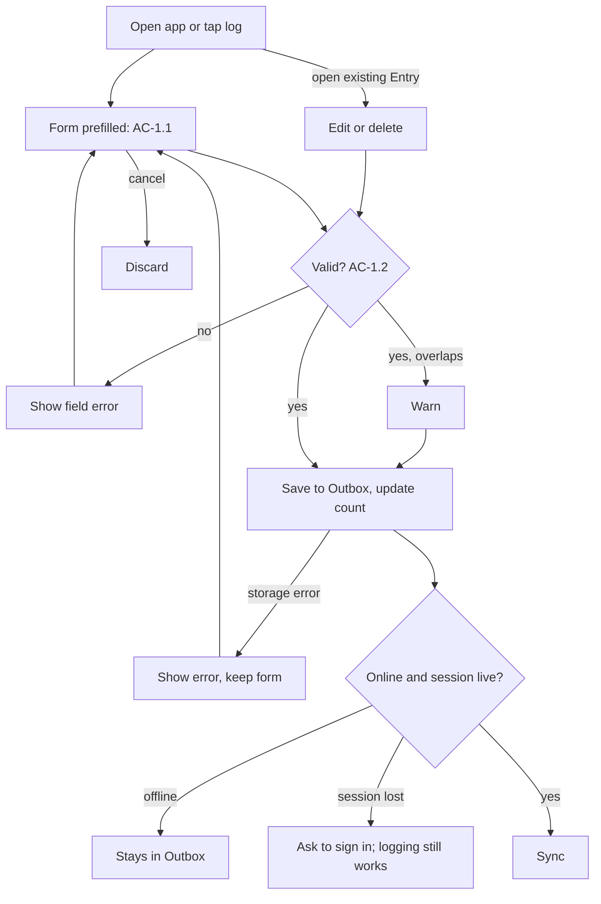
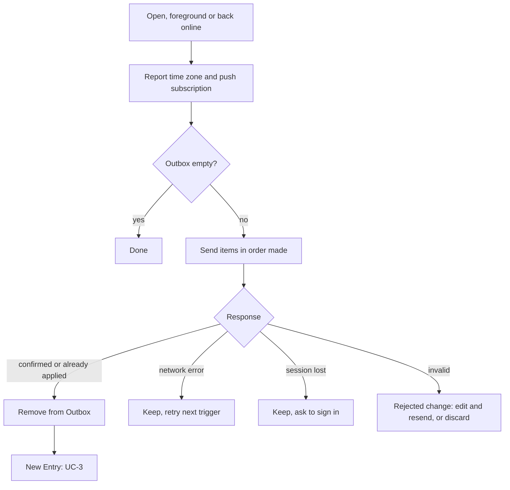
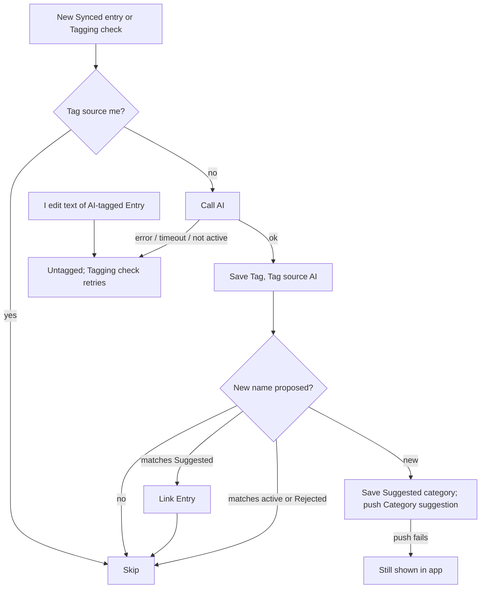
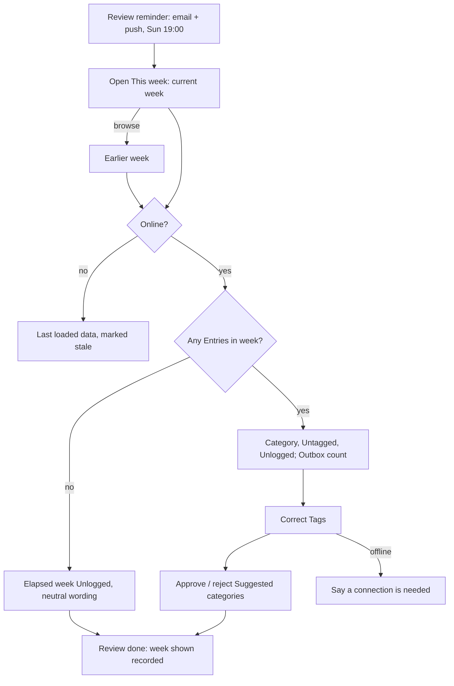
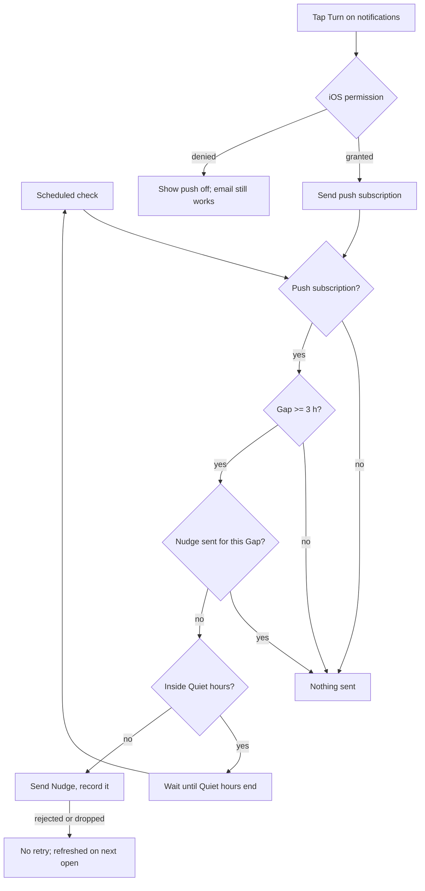
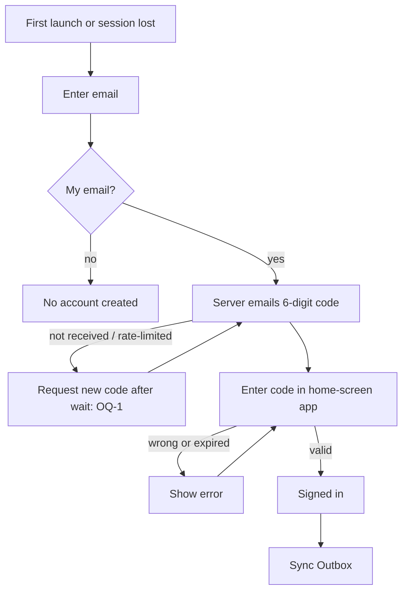

# daily-kaizen MVP: requirements

Direction: [ADR 0001](adr/0001-web-app-with-an-outbox-for-the-mvp.md) (web app with an Outbox),
[ADR 0002](adr/0002-queue-entry-edits-and-deletes-in-the-outbox.md) (edits and deletes in the Outbox) and
[ADR 0003](adr/0003-retry-untagged-entries-with-a-scheduled-check.md) (Tagging check). Sources:
[`docs/mvp-design.md`](../../mvp-design.md) (`mvp-design §…`), [`README.md`](../../../README.md) §Categories, and
[01-research.md](01-research.md) "Our system today" items 1 to 8 (`R1` to `R8`). Terms follow the
[00-brief.md](00-brief.md) Glossary. (judgement) marks points not in an approved doc. Each rule is stated once, in its
AC; use cases refer to it.

## Actors

| Actor | Description | Permissions |
|---|---|---|
| Me | The only user, on an iPhone (iOS 18.4+) home-screen web app, writing in English (brief Constraints) | Only my own rows (AC-7.2) |
| Server | Supabase database, Edge Functions and pg_cron jobs | Service role; jobs call functions with a shared secret |
| AI | Claude Haiku 5.5, called only by the Server to pick Tags | Sees an Entry's text and the active Categories |

## Use cases

### UC-1 · Log, edit or delete an entry
Me · I open the app or tap "log" · Signed in once on this phone (a live session is not required).
Main flow: 1. The form opens prefilled (AC-1.1). 2. I type the text, adjusting times if backfilling. 3. I save; the Entry goes to the Outbox (AC-1.2). 4. UC-2 runs if online.
Alternate flows: 2b. I open an existing Entry and edit or delete it (AC-1.3). 2c. I cancel → nothing is stored.
Exceptions: 3a. Invalid or overlapping → AC-1.2. 3b. Phone storage write fails → error, form kept filled (judgement).
Postconditions: the Entry or change is in the Outbox.

### UC-2 · Sync
App and Server · app opens, returns to the foreground or is back online · Outbox not empty.
Main flow: 1. The app sends each Outbox item. 2. The Server applies it (AC-2.3) and confirms. 3. The app removes it; a new Entry is now a Synced entry.
Exceptions: 1a. Offline or session lost → AC-2.4; a lost session also starts UC-6. 2a. Item invalid → AC-2.5. 2b. iOS cleared browser storage → Outbox items lost without trace; accepted by G3 (R1).
Postconditions: every confirmed item is applied once; no Server-owned field was overwritten.

### UC-3 · Tag an entry
Server · a new Synced entry, or the Tagging check finds an Untagged entry · Tag source is not me.
Main flow: 1. The Server sends the text and active Categories to the AI. 2. The AI picks one and may propose a new one. 3. The Server saves the Tag (AC-3.1) and handles any proposal (AC-3.4).
Exceptions: 1a. AI call fails, times out or returns an inactive Category (judgement) → Untagged, retried (AC-3.2). 3a. I set the Tag meanwhile → mine is kept (AC-3.3). 4a. Push off or failing → the Suggested category still shows in the app.
Postconditions: the Entry has exactly one Tag, or is Untagged and will be retried.

### UC-4 · Weekly review
Me · the Review reminder, or I open "This week" · Signed in, online for Server data.
Main flow: 1. The page shows the current week (AC-5.1); I may browse to an earlier week. 2. I correct wrong Tags (AC-4.1). 3. I approve or reject Suggested categories (AC-4.2, AC-4.3). 4. I tap "Review done" (AC-5.3).
Exceptions: 1a. No Entries in the week → all Unlogged, neutral wording (R8). 1b. Offline → last loaded data, marked as possibly out of date (judgement); changes need a connection (AC-4.1). 1c. Push not delivered (R4) → the email still arrives.
Postconditions: corrected Tags have Tag source me; approved Categories are active; the week shown has a Review done record.

### UC-5 · Nudge
Server · scheduled check · a push subscription exists.
Main flow: 1. The job finds a Gap of 3 hours. 2. The Server sends one Nudge (AC-6.1).
Exceptions: 1a. Outbox Entries are invisible to the Server → an unneeded Nudge is accepted (mvp-design §Push notifications). 2a. Gap reached inside Quiet hours → Nudge at their end, about 07:00; accepted (user decision). 2b. Push endpoint rejects or drops → no retry; subscription refreshed on next open (R4).
Postconditions: at most one Nudge per Gap, recorded.

### UC-6 · Sign in
Me · first launch or session lost.
Main flow: 1. I enter my email. 2. The Server emails a 6-digit code (Resend SMTP, R6). 3. I enter it (AC-7.1). 4. UC-2 runs.
Exceptions: 1a. Email isn't mine → no account is created (AC-7.2). 2a. Email not received or rate-limited → I request a new code after a wait (OQ-1). 3a. Wrong or expired code → error, retry.
Postconditions: the app holds a login session; the Outbox is unchanged and Syncs.

## User stories

### US-1 · As me, I want to log and fix entries in seconds, online or offline, so that logging stays a habit (G1, G2)
Logging burden (R8) is owned by the ui stage.
- AC-1.1 When the log form opens, the app shall prefill:
  - start with the latest end time among Entries on the phone (Outbox or last loaded), or the start of today if there is none;
  - end with the current time.
- AC-1.2 When I save an Entry, the app shall:
  - refuse, showing the wrong field, if the text is empty, end is not after start, or end is over 5 minutes after now (5 minutes is judgement);
  - warn, and still save, if it overlaps another Entry;
  - store it in the Outbox with a phone-created ID and the phone's IANA time zone before any network request, online or not, with or without a live login session (R2).
- AC-1.3 When I edit or delete an Entry, the app shall apply the AC-1.2 checks and store the change in the Outbox; for text, start and end, the latest change wins (ADR 0002).
- AC-1.4 While the Outbox is not empty, the app shall show a small count of its items, including Rejected changes. There is no export (R1).

### US-2 · As me, I want my Entries to reach the Server reliably, so that no Synced entry is lost (G3)
- AC-2.1 When the app opens or returns to the foreground, the app shall:
  - refresh the form defaults (AC-1.1) and Sync the Outbox;
  - report the phone's IANA time zone, which scheduled jobs then use;
  - send the current push subscription if push permission is granted (R4);
  - request persistent storage (ADR 0001).
- AC-2.2 When the app detects it is back online, the app shall Sync the Outbox.
- AC-2.3 When the Server receives an Outbox item (create, edit or delete), the Server shall:
  - apply it once by its own ID, so a resent item changes nothing;
  - apply an Entry's items in the order they were made on the phone, and never recreate a deleted Entry from a late create;
  - never change a Server-owned field from it, and confirm; the app shall then remove the item from the Outbox.
  The api stage owns the mechanism.
- AC-2.4 If Sync fails for network or login-session reasons, then the app shall keep the items, retry on the next AC-2.1 or AC-2.2 trigger, and keep them through sign-out and sign-in (R2).
- AC-2.5 If the Server rejects an item as invalid, then the app shall stop retrying it and show it with the reason, to edit and resend or discard (judgement).

### US-3 · As me, I want Entries tagged without my effort, so that the Weekly review needs no categorising (G1, G2)
Starting Categories: Deep, Shallow, Maintenance, Waste, Recovery (README §Categories); their descriptions are OQ-2.
- AC-3.1 When a new Entry is Synced, or the Tagging check picks up an Untagged entry, the Server shall ask the AI to pick one active Category and save it as the Tag with Tag source AI.
- AC-3.2 If an Entry is Untagged, because tagging failed or timed out, or because I changed the text of an Entry with Tag source AI (which clears its Tag), then the Tagging check shall retry it every 15 minutes (ADR 0003). Repeated tagging shall leave one Tag and at most one Suggested category and one Category suggestion.
- AC-3.3 If an Entry's Tag source is me, then the Server shall never change that Tag, even if I edit its text.
- AC-3.4 When the AI proposes a new category, the Server shall keep the Entry in the best active Category and:
  - if the name matches a Suggested category, link the Entry to it and send nothing;
  - if the name matches an active Category or a Rejected category, create nothing (judgement);
  - otherwise save a Suggested category and send a Category suggestion.

### US-4 · As me, I want to fix Tags and decide on Suggested categories, so that the Weekly review is accurate (G1)
- AC-4.1 When I change an Entry's Tag or decide on a Suggested category, the Server shall save it (a Tag with Tag source me); offline, the app shall say a connection is needed and change nothing (ADR 0002).
- AC-4.2 When I approve a Suggested category, the Server shall make it active and move to it the Entries linked to it, except those with Tag source me (judgement).
- AC-4.3 When I reject a Suggested category, the Server shall make it a Rejected category and leave all Tags unchanged (judgement). `docs/mvp-design.md` `categories.status` needs this third value.

### US-5 · As me, I want a Sunday review of where my time went, so that I complete weekly reviews (G1)
G1 counts a day as logged when at least one Synced entry starts that day in my time zone (judgement), and counts Review done records.
- AC-5.1 When I open the This week page, the app shall show the current week (Monday 00:00 to now), let me browse earlier weeks, and show for the week shown time per Category, Untagged and Unlogged, where:
  - days and weeks are split in my latest reported time zone (judgement), and an Entry crossing midnight or a week boundary counts in each part;
  - only past time counts;
  - overlapping time counts once, for the Entry created last;
  - Unlogged is elapsed time not covered by any Synced entry (the brief's Unlogged, as this page measures it);
  - Outbox items are not counted; the Outbox count (AC-1.4) is shown (judgement).
- AC-5.2 When it is Sunday 19:00 in my latest reported time zone, the Server shall send the Review reminder by email and by push.
- AC-5.3 When I tap "Review done", the Server shall record a Weekly review for the week shown, once per week, so a Monday review of last week counts.

### US-6 · As me, I want a Nudge when I forget to log, but never at night, so that days don't go Unlogged (G1)
- AC-6.1 When a Gap reaches 3 hours outside Quiet hours, and no Nudge was sent for that Gap, the Server shall send one Nudge; a Gap that reaches 3 hours inside Quiet hours gets its Nudge when Quiet hours end.
- AC-6.2 When I tap "Turn on notifications", the app shall ask iOS for permission and, if granted, send the push subscription; if denied, show that push is off and the Review reminder email still arrives (judgement).
- AC-6.3 When I change Quiet hours in settings (default 23:00–07:00), the Server shall use the new hours for the next Nudge; offline, the app shall say a connection is needed and change nothing.

### US-7 · As me, I want to sign in once with an emailed code, so that my Entries Sync to my account and stay mine (G3)
- AC-7.1 When I enter a valid 6-digit code from my email in the home-screen app, the app shall sign me in and Sync the Outbox.
- AC-7.2 The Server shall limit all data access to my account with row-level security, and shall refuse sign-ups from other emails (judgement).

## User flows

## Non-functional requirements

| Id | Quality | Scenario | Target |
|---|---|---|---|
| NFR-1 | Task time (G2) | App open → Entry saved, online or offline, one-line text; measured from open and save timestamps | ≤ 15 s for 9 of 10 Entries in the 14-day run (9 of 10 is judgement) |
| NFR-2 | Latency | Save tap → Entry stored in the Outbox and confirmed on screen | p95 < 300 ms on the iPhone |
| NFR-3 | Sync | App opens online with ≤ 50 items in the Outbox | Outbox empty within 10 s |
| NFR-4 | Tagging | Entry Synced → Tag saved | 95% within 30 min, allowing one Tagging check retry (ADR 0003) |
| NFR-5 | Durability (G3) | Synced entries | 0 lost; kept until deleted; daily free-plan backup (unverified) |
| NFR-6 | Schedule accuracy | Review reminder email | Sent within 5 min of Sunday 19:00 local, every week of the run |
| NFR-7 | Nudge limits | Per Gap; Quiet hours default 23:00–07:00 | ≤ 1 Nudge per Gap, 0 inside Quiet hours |
| NFR-8 | Data volume | Entries | ~30 a day, ~11,000 a year, within free plans |
| NFR-9 | Cost | All running services | < $5 a month |
| NFR-10 | Accessibility | Log form and This week page | WCAG 2.2 AA contrast; touch targets ≥ 44 pt |
| NFR-11 | Security | Data access and secrets | Row-level security on every table; AI, Resend and push keys only in Server secrets, never on the phone |
| NFR-12 | Availability | Supabase free-plan pause after low activity (R7) | 0 pauses in the 14-day run (OQ-5) |

## Out of scope

- Brief Non-goals: improvement experiments, AI suggestions, app tracking, other users, to-do lists, precise timesheets.
- Running timers (mvp-design §Logging); background Sync, Outbox loss detection and export (R1); push retries (R4).
- Offline Tag, Suggested category and Quiet hours changes (ADR 0002).
- Apple Shortcut logging (O4) and native app (O3).
- Contingency, not scope: if Web Push fails the device test or Nudges aren't delivered during the run, all push is dropped and the Review reminder goes by email only (01-research Recommendation).

## Open questions

| Id | Question | Owner stage |
|---|---|---|
| OQ-1 | How long before I can request a new sign-in code? | backend |
| OQ-2 | Descriptions of the starting Categories given to the AI | data-model |
| OQ-3 | Retry limit for an Entry that always fails tagging, and how it is shown (ADR 0003) | backend |
| OQ-4 | Which Outbox items the Server rejects as invalid, and the reasons shown (AC-2.5) | api |
| OQ-5 | Does the free-plan pause rule count pg_cron or Edge Function traffic? (R7) | backend |
| OQ-6 | Does the login session survive offline use and long gaps; can push re-subscribe without a tap? (R2, R4) | backend, device test |
| OQ-7 | Which sending domain Resend uses for the code and Review reminder emails (R6) | backend |
| OQ-8 | Which library the Server uses to send Web Push | backend, device test |
| OQ-9 | Do Dexie (IndexedDB) and Cloudflare Pages hosting behave as expected in the iOS home-screen app? | backend, device test |
| OQ-10 | pg_cron runs in UTC: how jobs convert Sunday 19:00 and Quiet hours from my time zone | backend |

## Glossary proposals

Merged into the brief's Glossary at approval.
