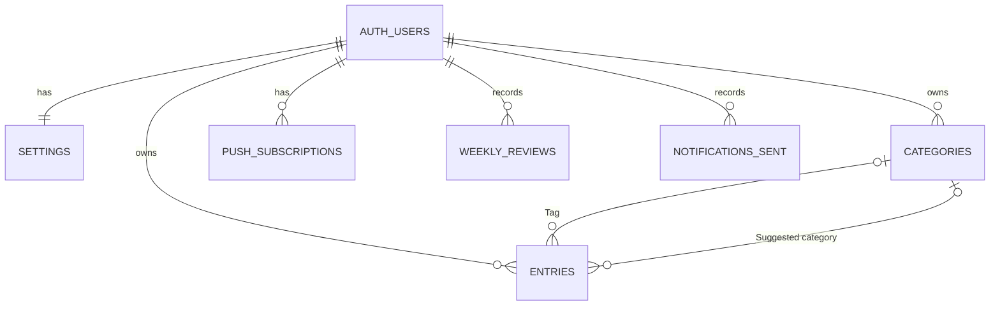

# daily-kaizen MVP: data model

All new; extends [`docs/mvp-design.md`](../../mvp-design.md) §Data under [D3](#decisions)
(writes online, read-only Local copy) and [D2](02-requirements.md#decisions) (Tagging check).
Conventions (Supabase defaults; no repo schema yet): snake_case plural tables, `uuid` keys, `timestamptz` times, and on every Server
table a `user_id` to the login user with row-level security limiting rows to the signed-in user (AC-7.2, NFR-11).
Only my account exists: sign-ups are disabled in the Supabase Auth settings and I create my login user once from the dashboard,
so no allowed-email record is stored; the emailed code still works for an existing user (AC-7.2).

## Entities

| Entity | Purpose | Owning module | New / changed | Lifecycle (created → … → deleted) |
|---|---|---|---|---|
| `entries` | Entries | `supabase/migrations` | New | I save → I edit, Server tags → I delete (hard delete) |
| `categories` | Active Categories, Suggested and Rejected categories | `supabase/migrations` | New | 5 starting ones with my account; tagging adds Suggested → active or Rejected; never deleted |
| `push_subscriptions` | Push subscriptions | `supabase/migrations` | New | Sent on each open → deleted when the push service reports it gone |
| `settings` | Time zone, Quiet hours and Nudge gap | `supabase/migrations` | New | Created with my account → updated by the app |
| `weekly_reviews` | Review done records | `supabase/migrations` | New | Created by "Review done" (AC-5.3); kept |
| `notifications_sent` | Record of each Nudge and Review reminder, to send once and to measure NFR-6, NFR-7 | `supabase/migrations` | New | Recorded before sending; kept |
| Local copy (phone storage, OQ-9) | The Local copy | `app/` | New | Replaced whole on each refresh (AC-2.3); disposable, rebuilt from the Server |

## ERD

## Attributes (new or changed only)

**SO** marks a Server-owned field.

| Entity.field | Type | Null | Default | Constraint / note |
|---|---|---|---|---|
| entries.id | uuid | no | | PK. Created by the phone when the form opens; a create with an existing id changes nothing (AC-2.2) |
| entries.text | text | no | | Not empty |
| entries.started_at, ended_at | timestamptz | no | | `ended_at > started_at`; `ended_at` at most 5 min after Server now (`entry_end_in_future`) |
| entries.time_zone | text | no | | IANA name at logging (AC-1.2), one Postgres knows (`time_zone_unknown`) |
| entries.form_opened_at | timestamptz | no | | Phone time the log form opened, sent on create, never changed. NFR-1 = `created_at − form_opened_at` |
| entries.category_id | uuid | yes | null | **SO**. The Tag; null = Untagged. FK, restrict |
| entries.tag_source | enum `ai`, `me` | yes | null | **SO**. Tag source |
| entries.tagged_at | timestamptz | yes | null | **SO**. When the current Tag was saved. NFR-4 = `tagged_at − created_at` |
| entries.suggested_category_id | uuid | yes | null | **SO**. The Entry's Suggested category (AC-3.4), so approval can move it (AC-4.2). FK, restrict |
| entries.tag_attempts | int | no | 0 | **SO**. Failed AI calls since the last Tag, counted only when the guarded update matches; reset by a text edit that clears the Tag |
| entries.tagging_gave_up_at | timestamptz | yes | null | **SO**. Set when `tag_attempts` reaches 3 (06-backend); the Tagging check skips the Entry; shown as Untagged with a "couldn't tag" note; I tag it by hand (AC-3.2) |
| entries.created_at | timestamptz | no | now() | **SO**. Server save time; also the save order used for overlaps (AC-5.1) |
| entries.updated_at | timestamptz | no | now() | **SO**. Set by a database trigger on every update |
| categories.id | uuid | no | generated | PK |
| categories.name | text | no | | Unique per user, case-insensitive, all statuses |
| categories.description | text | no | | For the AI; starting set below, AI-written for Suggested |
| categories.status | enum `active`, `suggested`, `rejected` | no | `active` | `rejected` is new vs the sketch (AC-4.3) |
| push_subscriptions.id | uuid | no | generated | PK |
| push_subscriptions.endpoint | text | no | | Unique |
| push_subscriptions.p256dh, auth | text | no | | The sketch's `keys` |
| settings.user_id | uuid | no | | PK |
| settings.time_zone | text | yes | null | Latest reported (AC-2.3), an IANA name Postgres knows (`time_zone_unknown`); jobs skip me while null |
| settings.quiet_start, quiet_end | time | no | 23:00, 07:00 | Local; may wrap midnight; `quiet_start <> quiet_end` (`quiet_hours_equal`) |
| settings.nudge_gap_hours | smallint | no | 3 | Whole hours, 1–12 (`nudge_gap_out_of_range`); the Gap length that triggers a Nudge (D6) |
| weekly_reviews.week_start | date | no | | Monday, my time zone, checked (`week_start_not_monday`); PK with `user_id` |
| weekly_reviews.done_at | timestamptz | no | now() | |
| notifications_sent.kind | enum `nudge`, `review_reminder` | no | | |
| notifications_sent.about | text | no | | For a Nudge, the Gap start; for a Review reminder, the week start. PK with `user_id`, `kind` |
| notifications_sent.sent_at | timestamptz | no | now() | Send time, for NFR-6 and NFR-7 |

Push is on when I have at least one `push_subscriptions` row; there is no separate on/off field (AC-6.2).
**Gap start**: the latest `ended_at` among my Entries; the Gap runs from it to now. With no Entries there is no Gap and no Nudge; deleting the latest Entry moves the Gap start back, and one Nudge per Gap still applies (user decision).

**Local copy** (phone, read-only, AC-2.4): copies of my Entries that end after the previous Monday 00:00 (this week and last week, including sleep crossing into Monday, and given-up Entries),
all my Categories, my settings, my `weekly_reviews` from the previous Monday on (Review done shown offline), and `refreshed_at`, the time of the last refresh shown on the This week page.

### Starting Category descriptions (resolves OQ-2)

Examples from README §Categories.

| Name | Description given to the AI |
|---|---|
| Deep | Focused, demanding work or learning that builds skill or produces something valuable, such as building a hard feature, studying a new topic or writing a design doc. |
| Shallow | Necessary work that needs little focus and is easy to interrupt, such as email and chat, quick admin or routine status meetings. |
| Maintenance | Chores and logistics that keep life running, such as cooking, cleaning, shopping, errands or commuting. |
| Waste | Time spent without intent that I wouldn't choose again, such as doomscrolling, aimless YouTube or switching between apps without doing anything. |
| Recovery | Deliberate rest that restores energy, such as sleep, a workout or walk, or a relaxed meal with friends. Entertainment chosen on purpose counts here; the same done aimlessly is Waste (user decision). |

## Invariants

| Rule | Enforced where |
|---|---|
| The phone writes only `text`, `started_at`, `ended_at`, `time_zone`, and `form_opened_at` on create; never an SO field | Both: write path, and no direct phone write rights on SO fields |
| A text change when `tag_source` isn't `me` (AI or null) clears the Tag, `tagged_at`, `suggested_category_id`, `tag_attempts` and `tagging_gave_up_at` in the same write (AC-3.2); with `me` they stay (AC-3.3) | Server write path |
| `category_id`, `tag_source` and `tagged_at` are all null or all set | DB check |
| A Tag points at an `active` Category | Server tagging and correction code |
| An AI Tag saves only if `tag_source` isn't `me` and `updated_at` is unchanged since the AI call began; otherwise nothing is saved and the Tagging check picks the Entry up if still Untagged | Server tagging code (conditional update) |
| Names unique per user, case-insensitive: at most one Suggested category per name, Rejected names never return | DB unique index |
| A Category suggestion is sent only for a newly inserted Suggested category | Server tagging code |
| Status moves only `suggested → active` or `suggested → rejected` | Server approve/reject code |
| One Nudge per Gap and one Review reminder per week | DB PK `(user_id, kind, about)` on `notifications_sent` |
| One Review done per week | DB PK `(user_id, week_start)` |
| The Local copy changes only by a whole refresh from the Server | App code |

## Access patterns

| Query or write (UC/AC id) | Frequency | Index or key | Expected volume and growth |
|---|---|---|---|
| Save, edit or delete an Entry (AC-1.2, 1.3) | ~30/day | `entries` PK | ~11,000 rows/year (NFR-8) |
| Untagged entries not given up, created over 2 min ago (AC-3.2) | Every 15 min | Partial index: `category_id` null and `tagging_gave_up_at` null | A handful |
| Entries overlapping a week; Local copy refresh (AC-5.1, 2.3) | Each open; few/week for older weeks | `(user_id, ended_at)`: Entries ending after the week start | ~200/week |
| Gap start for Nudge (AC-6.1) | Every few min | `(user_id, ended_at)` | 1 row |
| Categories (UC-3, AC-4.2) | Each tagging, review and refresh | None: < ~20 rows | Grows by approvals |
| Entries with a given Entry's Suggested category (AC-4.2) | Per approval | FK index `suggested_category_id` | Few |
| Settings, reviews, notifications, subscriptions (AC-5.2, 5.3, 6.1) | Per job or tap | PKs; unique `endpoint` | 1 row; ≤ 52/year; ~10/day; few |
| Form prefill (AC-1.1) | Each open | In memory over the Local copy | ≤ ~400 |

## Transactions and consistency

- **Entry write:** one row insert, update (including any Tag clearing) or delete.
- **Save a Tag:** one transaction inserts the Suggested category if the name is new and updates the Entry; if the Entry update matches no row (edited, re-tagged or deleted meanwhile), the transaction rolls back. The Category suggestion push goes after commit, only for a new insert.
- **Approve:** one transaction sets `active` and moves the Entries that have it as their Entry's Suggested category and are not tagged by me (AC-4.2), keeping their `tagged_at` and `tag_source`. **Reject:** one status update; Tags and `suggested_category_id` unchanged.
- **Nudge, Review reminder:** insert the `notifications_sent` row first, then send. A crash between loses one notification, consistent with no push retry (R4).
- **Phone:** a refresh replaces the whole Local copy in one write, so it is never half old and half new.
- **Deletes:** deleting my login user cascades to all my rows. Categories are never deleted, so Entry → Category references restrict. An Entry delete is a hard delete with no dependants; the next refresh drops it from the Local copy. Dead push subscriptions are deleted.

## Migration and backfill

Greenfield: one migration creates tables, indexes and policies; no running code or data, so no expand/contract or backfill.
Rollback drops the tables. Creating my account adds my `settings` row and the 5 starting Categories (mechanism: backend stage).
The Local copy has no migration: a new app version may discard and rebuild it. Update `docs/mvp-design.md` §Data to match at approval.

## Retention and privacy

- **PII:** email (Supabase login), Entry text (personal, may be sensitive), time zones (rough location), push endpoints. Single owner.
- **Shared with:** Anthropic receives Entry text and Category descriptions for tagging.
- **Retention:** Entries until I delete them; Review done and `notifications_sent` records kept for G1 and the NFRs.
- **Deletion and export:** deleting my login user removes everything; no in-app export, the Supabase dashboard can export. Daily free-plan backup is unverified (NFR-5).
- **Phone:** the Local copy holds this week's and last week's Entry text; losing it to iOS storage clearing loses nothing (G3).

## Decisions

### D3 · Require a connection for every write

The research and requirements stages first planned an Outbox on the phone, so Entries could be logged, edited and deleted
offline. Working through the data model showed its cost: change ordering, deletes of Entries the Server never saw,
rejected changes, phone-clock versioning, and best-effort iPhone storage that can lose unsynced Entries without a trace
(R1). For one user who is almost always online, that is a lot of design and code for a rare case. Drivers: G3 (no saved
Entry is ever lost), little code with light edge cases, and G2 (logging stays fast).

| Option | Outcome | Reason |
|---|---|---|
| Every write needs a connection; the phone keeps a read-only Local copy of this week and last week | **Chosen** | No sync rules; a saved Entry is on the Server the moment it is saved, so G3 holds without exceptions; the This week page and form defaults still work offline |
| Outbox for new Entries only; edits and deletes online | Rejected | Unsynced Entries sit in best-effort browser storage; a wrong time can't be fixed offline |
| Outbox for new Entries, edits and deletes; Tag and Category decisions online | Rejected | Sync must also carry updates and deletes, with ordering and phone-clock versioning, on top of the storage risk |
| Outbox for every write, including Tag corrections | Rejected | Offline Tag corrections conflict with AI tagging and need more rules |
| Fully online, with no local copy | Rejected | The This week page and the form defaults wouldn't work offline at all |

Consequences:
- I can't log, edit or delete without a connection. Missed time is logged later as a backfill, which the form supports.
- The Local copy can be out of date until the next online open; it is read-only.

### D6 · Make the Nudge gap a setting

I wanted to choose how long a Gap runs before a Nudge instead of the fixed 3 hours. Drivers: G1 (days don't go Unlogged), little code, and NFR-7 (one Nudge per Gap) staying true.

| Option | Outcome | Reason |
|---|---|---|
| Whole hours 1–12 in `settings`, default 3, still one Nudge per Gap | **Chosen** | One column and one check; the job already reads `settings`; hours are enough and the form is one number |
| A fixed 3 hours | Rejected | The first choice; I can't tune it when it nags or comes too late |
| Minutes or free text | Rejected | Finer control is not worth a unit, parsing and more error cases; the job runs every 5 minutes anyway |
| A Nudge repeating every gap | Rejected | Breaks "one Nudge per Gap" (NFR-7) and nags |

Consequences:
- Changing the gap mid-Gap uses the new value at the next job run; a Gap already Nudged stays Nudged (`notifications_sent` key), so lowering it never sends a second Nudge.

## Open questions

None. OQ-A (deliberate entertainment is Recovery, aimless is Waste) and OQ-B (Gap runs from the latest end time of any Entry) are closed by user decision.

## Glossary proposals

Merged into the brief's Glossary at approval.
