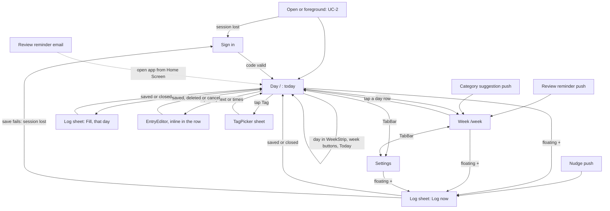

# daily-kaizen MVP: UI

Low fidelity. Inputs: [00-brief.md](00-brief.md), [02-requirements.md](02-requirements.md), [03-data-model.md](03-data-model.md),
[04-api.md](04-api.md); decisions D2 to D4. No `refs/` screenshots exist. The repo has no design system, so **every component
name below is new** (proposed). (judgement) marks choices not in an approved doc.

Logging burden (R8) is handled by three rules: a floating + on every screen opens the Log sheet, the only required input is
the text, and times are prefilled (AC-1.1), so a typical Entry is + → type → Save. A Nudge opens the sheet directly.
Backfilling any day is Fill on that day's Unlogged slots (AC-1.4, [D5](#decisions)).

## Screens

| Screen | Route / entry point | Use cases | New / changed | Main components (all new) |
|---|---|---|---|---|
| Day | `/` (today, app start); `/day/:date` (any other day, `YYYY-MM-DD`); Nudge opens `/` with the Log sheet | UC-1, UC-2 | New (replaces the Log form and the This week Entry list) | `WeekStrip`, `CoverageBar`, `EntryRow`, `SlotRow`, `EntryEditor`, `TagPicker`, `LogFab`, `LogSheet`, `RefreshedAt`, `ConnectionBanner`, `TabBar` |
| Log sheet | Bottom sheet over any screen: from the floating + (Log now) or a slot's Fill | UC-1 | New (the Log form, as a sheet) | `TimeChip`, `RecentChips`, `OverlapNote`, `SaveStatus` |
| Week | `/week` (current); `/week/:monday` (earlier); Review reminder, Category suggestion | UC-4 | Changed: summary only, no Entry list | `WeekHeader`, `RefreshedAt`, `CategoryTotals`, `DayTotals`, `SuggestedCategoryCard`, `ReviewDoneButton`, `LogFab`, `ConnectionBanner`, `TabBar` |
| Settings | `/settings` | AC-6.2, AC-6.3, AC-6.4 | New | `PushStatus`, `QuietHoursFields`, `NudgeGapField`, Diagnostics (p95 save and refresh), Sign out, `ConnectionBanner`, `TabBar` |
| Sign in | `/sign-in` (first launch, session lost) | UC-6 | New | `EmailStep`, `CodeInput` |

Why each new component exists: `TabBar` (three destinations, one tap each: Day, Week, Settings); `WeekStrip` (seven days in one
tappable row with round ‹ › week buttons, and a Today button off today; a day fits on screen, unlike one long week list);
`CoverageBar` (the day at a glance, 00–24, Category colours, slots grey); `SlotRow` (an Unlogged slot as a dashed row with a
visible Fill button; a hidden tap-on-empty-space gesture fails silently); `LogFab` (log now from anywhere, one tap); `LogSheet`
(one form for both Log now and Fill); `DayTotals` (one row per day with time logged, tap → that day); `TimeChip` (shows a prefilled time compactly, opens
the native time picker); `RecentChips` (fewer keystrokes, R8); `OverlapNote` (AC-1.2 warning without blocking); `SaveStatus`
(AC-2.1 "done only after Server confirms"); `ConnectionBanner` (AC-2.2, AC-2.4 offline and session states, one place);
`RefreshedAt` (AC-2.4); `TagPicker` (AC-4.1); `SuggestedCategoryCard` (AC-4.2, AC-4.3); `CodeInput` (AC-7.1).

## Navigation



## Wireframes

**Day** (`/`; mockups in #46)
```
+--------------------------------------+
| (ConnectionBanner, only when needed) |
|  Today                  ( < ) ( > )  |
|  Tue 10 Nov · week of Nov 9–15       |
|  Mon [Tue] Wed Thu Fri Sat Sun       |
|   9   10   11  12  13  14  15        |
|   ▃    ▂             (time logged)   |
|  [░░░░██▓█░██░░░░░░░░░░░░░░░]        |
|  00     06     12     18     24      |
|  Logged 5h 10m       Updated 14:02   |
|  07:00-08:00 Email triage  [Shallow] |
|  08:00-10:00 Wrote design doc [Deep] |
|  10:00-10:15 Standup     [Untagged]  |
|  ┊10:15-11:45 1h 30m unlogged  Fill┊ |
|  11:45-12:45 Lunch walk  [Recovery]  |
|  ┊12:45-now   1h 40m unlogged  Fill┊ |
|                                 (+)  |
|--------------------------------------|
|    Day    |    Week    |  Settings   |
+--------------------------------------+
```
On a day other than today the title is that date ("Mon 9 Nov") and a `[Today]` button sits left of the week buttons. Days after
today are greyed and can't be picked. A day with no Entries shows one row, "Nothing logged" with Fill over the whole day up to
now. Editing happens in the row: tapping an Entry's text or times expands it in place (one row at a time) into: text, From and
To `TimeChip`s (same day), `[Save]` `[Cancel]` and `Delete` → "Delete? [Yes] [No]". Save and Delete need a connection (D3);
offline the editor shows "Saving needs a connection." and both are disabled. Changing the text re-tags the Entry unless its Tag
source is me (04-api). Tag changes stay on the Tag chip, with the "couldn't tag" note under the row.

**Log sheet** (Log now from +; Fill from a slot)
```
+--------------------------------------+
|                 ---                  |
|  What did you do?                    |
|  (Fill: "Fill the gap",              |
|   "Mon 9 Nov · 19:00-23:30")         |
|  [ Reading PR reviews_____________ ] |
|  Recent: (email) (lunch) (commute)   |
|  From [ 14:25 ]   To [ 14:35 ] now   |
|  ! Overlaps "Standup" 10:30-10:45.   |
|    It will still be saved.           |
|  [            Save             ]     |
|  Saved.                (SaveStatus)  |
+--------------------------------------+
```
Swipe down, tap outside or Escape closes it. Closing with text asks nothing: the text is kept for the next open of the same
sheet until it is saved or cleared.

**Week**
```
+--------------------------------------+
|  Week                   ( < ) ( > )  |
|  Nov 2–8 · Updated 14:02 Review done ✓|
|--------------------------------------|
|  Deep         ██████████   12h 30m   |
|  Shallow      ██████        7h 10m   |
|  Recovery     ████████████ 15h 20m   |
|  Untagged     █             0h 40m   |
|  Unlogged     ░░░░░░       31h 15m   |
|--------------------------------------|
|  Mon 2   ███████░░░░   6h 00m    >   |
|  Tue 3   █████░░░░░░   5h 10m    >   |
|  ...                                 |
|--------------------------------------|
|  Suggested category: Admin           |
|  "Forms, bills, paperwork"           |
|  3 Entries would move.               |
|  [ Approve ]  [ Reject ]             |
|  [       Mark review done       ]    |
|                                 (+)  |
|--------------------------------------|
|    Day    |    Week    |  Settings   |
+--------------------------------------+
```

**Settings**
```
+--------------------------------------+
|  Notifications                       |
|  Push: Off                           |
|  [ Turn on notifications ]           |
|  The Sunday email arrives either way.|
|--------------------------------------|
|  Quiet hours (no Nudges)             |
|  From [ 23:00 ]  To [ 07:00 ]        |
|--------------------------------------|
|  Nudge gap                           |
|  Remind me after                     |
|  [ 3 hours without a log      v ]    |
|--------------------------------------|
|  [ Save ]                            |
|--------------------------------------|
|  Diagnostics                         |
|  Usually this fast or faster on this |
|  device: save 420 ms · refresh 610 ms|
|--------------------------------------|
|  Account                             |
|  [ Sign out ]                        |
|--------------------------------------|
|    Day    |    Week    |  Settings   |
+--------------------------------------+
```
Settings also shows the floating +.

**Sign in**
```
+--------------------------------------+
|  daily-kaizen                        |
|  Email [ me@example.com_______ ]     |
|  [ Send code ]                       |
|                                      |
|  Enter the 6-digit code we emailed.  |
|  [ _ _ _ _ _ _ ]                     |
|  [ Sign in ]     Send a new code     |
+--------------------------------------+
```

## States

All writes show done only after the Server confirms (AC-2.1). The `ConnectionBanner` texts are shared:
offline: "Offline. Showing data from 14:02. Saving needs a connection."; session lost: "Signed out. [Sign in] to save."

| Screen | Empty | Loading | Error | Partial | Success | No permission |
|---|---|---|---|---|---|---|
| Day | No Entries that day: one "Nothing logged" row with Fill | Local copy not read yet, or a day older than the Local copy being fetched: skeleton rows | Older day offline: "Earlier days need a connection." with Retry; write errors inline in the row | Offline: Local copy with `RefreshedAt`; Fill and + still open the sheet, Save reports "Needs a connection." | Day shown; after any confirmed write the day is read again | Session lost: banner; reading still works |
| Log sheet | No Local copy Entries: start = 00:00 today (AC-1.1); `RecentChips` hidden | Save button reads "Saving…", disabled; fields read-only | Field errors per 04-api Errors on the field; "Needs a connection. Your text is kept. Tap Save again." (same id, safe resend); 5xx "Couldn't save. Try again." | Offline: sheet works, banner shown, Save tries and reports | "Saved." then the sheet closes; Local copy refreshes; the next Log now starts by AC-1.1, and the rest of a filled slot stays on the day | Session lost: banner, text kept in memory, sign in, return to the sheet |
| Week | No Entries in the week: "Nothing logged this week yet." Totals show only Unlogged | First open with no Local copy, or an earlier week: skeleton rows | Earlier week offline: "Earlier weeks need a connection." with Retry; write errors shown inline on the card | Offline: Local copy with `RefreshedAt`; Approve, Reject, Review done show "Needs a connection." on tap | Week shown; Review done badge if recorded | Session lost: banner; reading the Local copy still works |
| Settings | Push never asked: "Push: Off" and the button | "Saving…" on Save | `quiet_hours_equal` "Start and end must differ."; `nudge_gap_out_of_range` "Choose 1 to 12 hours."; offline "Needs a connection." | Not on the Home Screen: "Add daily-kaizen to your Home Screen first: Share → Add to Home Screen." button hidden | "Saved." / "Push: On" | Denied: "Push is off. Turn it on in iOS Settings → Notifications → daily-kaizen. The Sunday email still arrives." |
| Sign in | Email step only | "Sending…", "Signing in…" | "Wrong or expired code."; rate-limited: "Wait a moment, then send a new code." | Opened in a browser, not the home-screen app: numbered, illustrated Add to Home Screen steps for Safari or Chrome on iPhone; any other device: "Open daily-kaizen on your iPhone" with the address (AC-7.1) | Goes to Day; Local copy refreshes | New email: same "A 6-digit code is on its way." and a new account (AC-7.2) |

**Loading rule (every screen).** Anything read from the Local copy, the browser or the Server shows a `Skeleton` (grey block the size of the content) until the read has finished, never a default as if it were real: no "Push: Off", no 23:00, no "Not reviewed", no "Not updated yet", no empty state. Empty states show only after loading ends. A page with a pending read sets `aria-busy` on `<main>` (`Phone busy`). The skeleton stays invisible for 150 ms so a fast read doesn't flash, has the content's size so nothing jumps, and its pulse stops under `prefers-reduced-motion`. Save buttons that would send a placeholder stay disabled until the read ends. Screens read the Local copy through `useLocalCopy()` (`ready`) and pass `loading` down.

Wording rules (R8): Unlogged is a plain grey row, never red, never "missed" or "wasted"; no streaks or scores. Untagged is grey
with no warning icon. The "couldn't tag" note asks for an action, not blame. "Send a new code" is enabled after TBD: the wait (OQ-1, backend).

## Interactions

No optimistic updates anywhere (D3). After any confirmed write the app refreshes the Local copy (AC-2.3).

| Screen | User action | API operation | Optimistic update? | On error |
|---|---|---|---|---|
| Any | Open or foreground, online | Local copy refresh (4 reads); `PATCH /settings {time_zone}`; `POST /push_subscriptions` if permission granted | No | Keep old Local copy and `RefreshedAt`; 401 → Sign in |
| Log sheet | Save new (Log now or Fill) | `POST /entries` with id made at sheet open, `form_opened_at` | No | Per Errors table; resend reuses the id; `201 []` → `PATCH` the same id |
| Log sheet | Tap a Recent chip | none (fills text from Local copy) | n/a | n/a |
| Day | Pick a day, week buttons, Today | Local copy for current and previous week; older: `GET /entries` for that day's week (as earlier weeks) | n/a | Offline message with Retry |
| Day | Save in `EntryEditor` | `PATCH /entries?id=eq.:id` | No | Errors inline in the row; `entry_not_found` "This Entry was deleted." + refresh |
| Day | Delete in `EntryEditor` | `DELETE /entries?id=eq.:id` | No | "Needs a connection."; already gone counts as done |
| Day | Pick a Tag in `TagPicker` (Active Categories only) | `rpc/set_entry_tag` | No | `category_not_active` "Pick another category." + refresh; `entry_not_found` + refresh |
| Week | Week buttons | Local copy for current and previous week; earlier: `GET /entries` for that week | n/a | Offline message with Retry |
| Week | Approve / Reject | `rpc/approve_category` / `rpc/reject_category` | No | `category_already_decided` → refresh silently |
| Week | Mark review done | `POST /weekly_reviews {week_start}` | No | "Needs a connection."; `[]` counts as done |
| Settings | Turn on notifications | iOS permission prompt, then `POST /push_subscriptions` | No | Denied → No-permission state; send fails → "Couldn't turn on. Try again." |
| Settings | Save Quiet hours and Nudge gap | `PATCH /settings {quiet_start, quiet_end, nudge_gap_hours}` | No | Per Errors table |
| Settings | Sign out | `signOut({scope: 'local'})` (this device only), then clear the Local copy, go to Sign in | No | Offline: button disabled, "Signing out needs a connection."; fails: "Couldn't sign out. Try again.", session and Local copy kept |
| Sign in | Send code / Sign in | `signInWithOtp` (creates new users) / `verifyOtp` | No | See States |

Overlap check (AC-1.2) runs on the phone against the Local copy whenever times change, skipping the Entry being edited; it never blocks Save.
Both `TimeChip`s are native `<input type="time">`, so a tap opens the iOS time wheel. In Log now (+) a picked time means its most recent occurrence: To is the latest such time not after now, and From the latest before To, so a To later than the clock means yesterday and an Entry can cross midnight (#49). In Fill, To is on the slot's day and From is the latest such time before To. A chip on a day other than today says so ("yesterday", else e.g. "Mon 9"). In the `EntryEditor`, times stay on the Entry's day. The To chip shows "now" and keeps following the clock until I change it, and "Use now" puts it back. The checks run as I pick: From must be before To, and To can't be later than now. Save stays disabled until both pass.

**Rules the critic asked for:**
- **Fresh form.** Whenever the Log sheet opens (+, Fill, Nudge tap), or the app returns to the foreground with it open, and its
  text is empty, it gets a new id and `form_opened_at` = now, and its times are prefilled again. If text is there, both are kept
  so an unconfirmed save can resend. A Nudge tap always opens `/` with the Log now sheet; a plain foreground stays on the last screen.
- **Day.** `/` always opens on today (judgement, #46). Unlogged slots are at least 10 minutes; time before a past day's first
  Entry and after its last isn't a slot (usually sleep). An Entry crossing midnight shows on both days, clipped. Overlapping
  Entries both show, and the overlap is not a slot.
- **Session.** On open with no session, go to Sign in. A 401 during use shows the banner and keeps what is on screen.
  Sign out (Settings) ends this device's session only and clears its Local copy. Push subscriptions are kept, so Nudges still
  arrive (one user, my email only). Rejected: deleting the subscription on sign-out (an extra write that fails offline, no gain with one user).
- **Earlier weeks.** `EntryEditor` and `TagPicker` work on the day shown, from the Local copy or the fetched earlier week. After a
  confirmed write while an earlier week is shown, that week is read again with the same `GET`.
- **Couldn't tag.** The note shows only when `tagging_gave_up_at` is set and `category_id` is null.
- The Storybook mockups in `app/` show every screen and state in this doc (`npm run storybook`).

### Notifications and emails

| Message | Title / subject | Body | Opens |
|---|---|---|---|
| Nudge (push) | "Time to log?" | "Your last Entry ended at 14:10. What have you been doing?" | `/` Day with the Log now sheet open |
| Review reminder (push) | "Weekly review" | "Your week is ready. See where your time went." | `/week` |
| Review reminder (email) | "Your weekly review is ready" | "See where your time went this week. Open daily-kaizen from your Home Screen and go to Week." | No link (judgement): a link opens Safari, not the home-screen app |
| Category suggestion (push) | "New category suggested: Admin" | "Approve or reject it on Week." | `/week` |
| Sign-in code (email) | "Your daily-kaizen code: 123456" | "Enter this code in daily-kaizen. It expires soon. If you didn't ask for it, ignore this email." | none |

## Accessibility and responsiveness

- **Keyboard path** (external keyboard, also VoiceOver order): Day: week buttons → Today → day strip → Entry and slot rows (text
  link, Tag button, Fill) → +. Log sheet: text → Recent chips → From → To → Save; Enter in the text field saves; Escape closes
  and returns focus to + or Fill. TabBar is last. Week: week buttons → Review done → totals → day rows → Suggested category
  buttons → Mark review done. Every screen has bottom padding so the + never covers the last control. `TagPicker` traps focus, Escape closes and returns focus to the Tag button.
- **Labels:** every field has a visible label; `TimeChip` announces "Start, 09:40". `CodeInput` is one field with
  `inputmode="numeric"` and `autocomplete="one-time-code"` so iOS offers the code from Mail.
- **Feedback:** `SaveStatus`, `ConnectionBanner` and field errors are `aria-live="polite"`; on error, focus moves to the first wrong field.
- **Contrast and targets:** WCAG 2.2 AA, including grey Unlogged and Untagged text; bars always have a text value, so colour is never
  the only signal; touch targets ≥ 44 pt (NFR-10).
- **Focus on open:** the text field is focused when the Log sheet opens. TBD: whether iOS raises the keyboard without a tap in the
  home-screen app (device test); if not, it costs one tap.
- **Layout:** one column, portrait iPhone widths 375–440 pt, safe-area insets for the notch and home bar; on wider screens the column
  is centred, max 480 px. Text scales with the iOS text size setting.

## Look and feel

Calm, plain and quick: system font, white or dark background following the phone setting, one accent colour for Save and the
selected tab. Dense enough that the whole Log sheet fits above the keyboard. Category colours are muted and fixed per Category;
Unlogged and Untagged are neutral grey. No celebration, streaks or guilt wording. No reference screenshots in `refs/`.

## Open questions

Approved by the user on 2026-11-06 with these left open (current default in brackets):
- Recent chips on the Log sheet: keep, and how many? [keep, 5 most recent distinct texts]
- Review reminder email: link or plain instructions? [plain instructions; a link opens Safari, not the home-screen app]
- Unlogged: per day as well as the week total? [resolved by D5: slots per day on Day, time logged per day on Week]
- Backfilling a different day [resolved by D5: Fill on any day's Unlogged slots]

## Decisions

### D5 · One Day view for logging, reviewing and backfilling (#46, approved 2026-11-10)
Problem: I couldn't log last night (To was always today), the This week list grew so long that later days needed a lot of
scrolling, and backfilling needs to show what is missing. Light research (sources in #46): time trackers show gaps in a day list
and create an entry from the gap (Uku, Timeular, TMetric, DeskTime); a 7-day strip is the usual way to pick a nearby day.

| Option | Verdict | Why |
|---|---|---|
| Day view: week strip, Entries with Unlogged slots and Fill; Week becomes a summary; floating + for Log now | **Chosen** | Any day can be backfilled without typing a date; the slot gives the times; each page fits on screen |
| Log form only, where a To later than now means yesterday (#49) | Rejected as the whole answer | Only last night; kept inside Log now for an Entry crossing midnight |
| A Day field on the Log form | Rejected | Logging blind: you don't see what is missing that day |
| Date and time in both From and To | Rejected | Heavier pickers on every log, including the everyday "just now" |
| "+ Add" per day on the This week list | Rejected | Keeps the long week list |
| Quick-add bar at the bottom of the Day view | Rejected (user, #46) | A floating + works on every screen |
| "‹ Nov 9–15 ›" text as the week control | Rejected (user, #46) | Didn't look tappable; round icon buttons instead |
