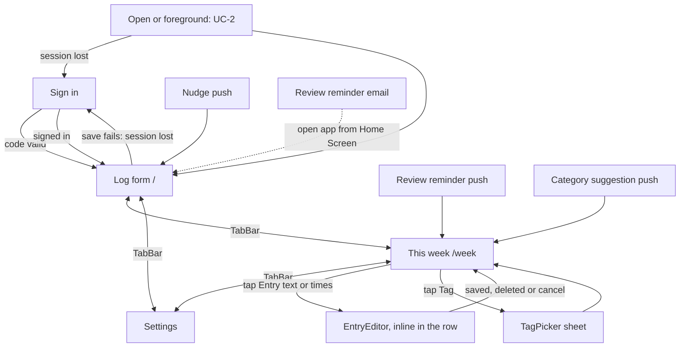

# daily-kaizen MVP: UI

Low fidelity. Inputs: [00-brief.md](00-brief.md), [02-requirements.md](02-requirements.md), [03-data-model.md](03-data-model.md),
[04-api.md](04-api.md); decisions D2 to D4. No `refs/` screenshots exist. The repo has no design system, so **every component
name below is new** (proposed). (judgement) marks choices not in an approved doc.

Logging burden (R8) is handled by three rules: the app opens on the Log form, the only required input is the text, and
times are prefilled (AC-1.1), so a typical Entry is open → tap text → type → Save.

## Screens

| Screen | Route / entry point | Use cases | New / changed | Main components (all new) |
|---|---|---|---|---|
| Log form | `/` (app start, Nudge) | UC-1, UC-2 | New | `LogForm`, `TimeChip`, `RecentChips`, `OverlapNote`, `SaveStatus`, `ConnectionBanner`, `TabBar` |
| This week | `/week` (current); `/week/:monday` (earlier); Review reminder, Category suggestion | UC-4 | New | `WeekHeader`, `RefreshedAt`, `CategoryTotals`, `SuggestedCategoryCard`, `EntryRow`, `EntryEditor`, `TagPicker`, `ReviewDoneButton`, `ConnectionBanner`, `TabBar` |
| Settings | `/settings` | AC-6.2, AC-6.3, AC-6.4 | New | `PushStatus`, `QuietHoursFields`, `NudgeGapField`, Diagnostics (p95 save and refresh), Sign out, `ConnectionBanner`, `TabBar` |
| Sign in | `/sign-in` (first launch, session lost) | UC-6 | New | `EmailStep`, `CodeInput` |

Why each new component exists: `TabBar` (three destinations, one tap each); `TimeChip` (shows a prefilled time compactly, opens
the native time picker); `RecentChips` (fewer keystrokes, R8); `OverlapNote` (AC-1.2 warning without blocking); `SaveStatus`
(AC-2.1 "done only after Server confirms"); `ConnectionBanner` (AC-2.2, AC-2.4 offline and session states, one place);
`RefreshedAt` (AC-2.4); `TagPicker` (AC-4.1); `SuggestedCategoryCard` (AC-4.2, AC-4.3); `CodeInput` (AC-7.1).

## Navigation



## Wireframes

**Log form (new Entry)**
```
+--------------------------------------+
| (ConnectionBanner, only when needed) |
|  What did you do?                    |
|  [ Reading PR reviews_____________ ] |
|  Recent: (email) (lunch) (commute)   |
|                                      |
|  From [ 09:40 ]   To [ now 10:52 ]   |
|  ! Overlaps "Standup" 10:30-10:45.   |
|    It will still be saved.           |
|                                      |
|  [            Save             ]     |
|  Saved.                (SaveStatus)  |
|--------------------------------------|
|   Log    |  This week  |  Settings   |
+--------------------------------------+
```
Editing happens in the This week list, not on a separate page. Tapping an Entry's text or times expands that row in place
(one row at a time) into: text, From and To `TimeChip`s (same day), `[Save]` `[Cancel]` and `Delete` → "Delete? [Yes] [No]".
Save and Delete need a connection (D3); offline the editor shows "Saving needs a connection." and both are disabled.
Changing the text re-tags the Entry unless its Tag source is me (04-api). Tag changes stay on the Tag chip.

**This week**
```
+--------------------------------------+
|  <  Week of 2 Nov  >    Review done ✓|
|  Updated 14:02 (RefreshedAt)         |
|--------------------------------------|
|  Deep         ██████████   12h 30m   |
|  Shallow      ██████        7h 10m   |
|  Maintenance  ████          5h 00m   |
|  Recovery     ████████████ 15h 20m   |
|  Waste        ██            2h 05m   |
|  Untagged     █             0h 40m   |
|  Unlogged     ░░░░░░       31h 15m   |
|--------------------------------------|
|  Suggested category: Admin           |
|  "Forms, bills, paperwork"           |
|  3 Entries would move.               |
|  [ Approve ]  [ Reject ]             |
|--------------------------------------|
|  Tue 4 Nov                           |
|  09:00-10:30 Wrote design doc [Deep] |
|  10:30-10:45 Standup     [Untagged]  |
|  11:00-11:20 Tax form  [Untagged ▾]  |
|    Couldn't tag this one. Pick a     |
|    category.                         |
|  ...                                 |
|  [       Mark review done       ]    |
|--------------------------------------|
|   Log    |  This week  |  Settings   |
+--------------------------------------+
```

**Settings**
```
+--------------------------------------+
|  Notifications                       |
|  Push: Off                           |
|  [ Turn on notifications ]           |
|  The Sunday email arrives either way.|
|--------------------------------------|
|  Quiet hours (no Nudges)             |
|  From [ 23:00 ]  To [ 07:00 ]        |
|--------------------------------------|
|  Nudge gap                           |
|  Remind me after                     |
|  [ 3 hours without a log      v ]    |
|--------------------------------------|
|  [ Save ]                            |
|--------------------------------------|
|  Diagnostics                         |
|  Usually this fast or faster on this |
|  device: save 420 ms · refresh 610 ms|
|--------------------------------------|
|  Account                             |
|  [ Sign out ]                        |
|--------------------------------------|
|   Log    |  This week  |  Settings   |
+--------------------------------------+
```

**Sign in**
```
+--------------------------------------+
|  daily-kaizen                        |
|  Email [ me@example.com_______ ]     |
|  [ Send code ]                       |
|                                      |
|  Enter the 6-digit code we emailed.  |
|  [ _ _ _ _ _ _ ]                     |
|  [ Sign in ]     Send a new code     |
+--------------------------------------+
```

## States

All writes show done only after the Server confirms (AC-2.1). The `ConnectionBanner` texts are shared:
offline: "Offline. Showing data from 14:02. Saving needs a connection."; session lost: "Signed out. [Sign in] to save."

| Screen | Empty | Loading | Error | Partial | Success | No permission |
|---|---|---|---|---|---|---|
| Log form | No Local copy Entries: start = 00:00 today (AC-1.1); `RecentChips` hidden | Save button reads "Saving…", disabled; fields read-only | Field errors per 04-api Errors on the field; "Needs a connection. Your text is kept. Tap Save again." (same id, safe resend); 5xx "Couldn't save. Try again." | Offline: form works, banner shown, Save tries and reports | "Saved." for 2 s; Local copy refreshes; form resets: text empty, start by AC-1.1 (latest end in the Local copy), end = now, new id | Session lost: banner, text kept in memory, sign in, return to the form |
| This week | No Entries in the week: "Nothing logged this week yet." Totals show only Unlogged; `[Log something]` | First open with no Local copy, or an earlier week: skeleton rows | Earlier week offline: "Earlier weeks need a connection." with Retry; write errors shown inline on the card or row | Offline: Local copy with `RefreshedAt`; Approve, Reject, Tag, Review done show "Needs a connection." on tap | Week shown; Review done badge if recorded | Session lost: banner; reading the Local copy still works |
| Settings | Push never asked: "Push: Off" and the button | "Saving…" on Save | `quiet_hours_equal` "Start and end must differ."; `nudge_gap_out_of_range` "Choose 1 to 12 hours."; offline "Needs a connection." | Not on the Home Screen: "Add daily-kaizen to your Home Screen first: Share → Add to Home Screen." button hidden | "Saved." / "Push: On" | Denied: "Push is off. Turn it on in iOS Settings → Notifications → daily-kaizen. The Sunday email still arrives." |
| Sign in | Email step only | "Sending…", "Signing in…" | "Wrong or expired code."; rate-limited: "Wait a moment, then send a new code." | Opened in a browser, not the home-screen app: numbered, illustrated Add to Home Screen steps for Safari or Chrome on iPhone; any other device: "Open daily-kaizen on your iPhone" with the address (AC-7.1) | Goes to Log form; Local copy refreshes | New email: same "A 6-digit code is on its way." and a new account (AC-7.2) |

**Loading rule (every screen).** Anything read from the Local copy, the browser or the Server shows a `Skeleton` (grey block the size of the content) until the read has finished, never a default as if it were real: no "Push: Off", no 23:00, no "Not reviewed", no "Not updated yet", no empty state. Empty states show only after loading ends. A page with a pending read sets `aria-busy` on `<main>` (`Phone busy`). The skeleton stays invisible for 150 ms so a fast read doesn't flash, has the content's size so nothing jumps, and its pulse stops under `prefers-reduced-motion`. Save buttons that would send a placeholder stay disabled until the read ends. Screens read the Local copy through `useLocalCopy()` (`ready`) and pass `loading` down.

Wording rules (R8): Unlogged is a plain grey row, never red, never "missed" or "wasted"; no streaks or scores. Untagged is grey
with no warning icon. The "couldn't tag" note asks for an action, not blame. "Send a new code" is enabled after TBD: the wait (OQ-1, backend).

## Interactions

No optimistic updates anywhere (D3). After any confirmed write the app refreshes the Local copy (AC-2.3).

| Screen | User action | API operation | Optimistic update? | On error |
|---|---|---|---|---|
| Any | Open or foreground, online | Local copy refresh (4 reads); `PATCH /settings {time_zone}`; `POST /push_subscriptions` if permission granted | No | Keep old Local copy and `RefreshedAt`; 401 → Sign in |
| Log form | Save new | `POST /entries` with id made at form open, `form_opened_at` | No | Per Errors table; resend reuses the id; `201 []` → `PATCH` the same id |
| Log form | Tap a Recent chip | none (fills text from Local copy) | n/a | n/a |
| This week | ‹ / › week | Local copy for current and previous week; earlier: `GET /entries` for that week | n/a | Offline message with Retry |
| This week | Save in `EntryEditor` | `PATCH /entries?id=eq.:id` | No | Errors inline in the row; `entry_not_found` "This Entry was deleted." + refresh |
| This week | Delete in `EntryEditor` | `DELETE /entries?id=eq.:id` | No | "Needs a connection."; already gone counts as done |
| This week | Pick a Tag in `TagPicker` (Active Categories only) | `rpc/set_entry_tag` | No | `category_not_active` "Pick another category." + refresh; `entry_not_found` + refresh |
| This week | Approve / Reject | `rpc/approve_category` / `rpc/reject_category` | No | `category_already_decided` → refresh silently |
| This week | Mark review done | `POST /weekly_reviews {week_start}` | No | "Needs a connection."; `[]` counts as done |
| Settings | Turn on notifications | iOS permission prompt, then `POST /push_subscriptions` | No | Denied → No-permission state; send fails → "Couldn't turn on. Try again." |
| Settings | Save Quiet hours and Nudge gap | `PATCH /settings {quiet_start, quiet_end, nudge_gap_hours}` | No | Per Errors table |
| Settings | Sign out | `signOut({scope: 'local'})` (this device only), then clear the Local copy, go to Sign in | No | Offline: button disabled, "Signing out needs a connection."; fails: "Couldn't sign out. Try again.", session and Local copy kept |
| Sign in | Send code / Sign in | `signInWithOtp` (creates new users) / `verifyOtp` | No | See States |

Overlap check (AC-1.2) runs on the phone against the Local copy whenever times change, skipping the Entry being edited; it never blocks Save.
Both `TimeChip`s are native `<input type="time">`, so a tap opens the iOS time wheel. Times are on the Entry's day (today for a new Entry). The To chip shows "now" and keeps following the clock until I change it, and "Use now" puts it back. The checks run as I pick: From must be before To, and To can't be later than now. Save stays disabled until both pass.

**Rules the critic asked for:**
- **Fresh form.** Whenever the Log form is shown (cold start, foreground, Nudge tap, Log tab) and its text is empty, it gets a new
  id and `form_opened_at` = now, and From is prefilled again. If text is there, both are kept so an unconfirmed save can resend.
  A Nudge tap always opens `/`; a plain foreground stays on the last screen.
- **Session.** On open with no session, go to Sign in. A 401 during use shows the banner and keeps what is on screen.
  Sign out (Settings) ends this device's session only and clears its Local copy. Push subscriptions are kept, so Nudges still
  arrive (one user, my email only). Rejected: deleting the subscription on sign-out (an extra write that fails offline, no gain with one user).
- **Earlier weeks.** `EntryEditor` and `TagPicker` work on the week shown, from the Local copy or the fetched earlier week. After a
  confirmed write while an earlier week is shown, that week is read again with the same `GET`.
- **Couldn't tag.** The note shows only when `tagging_gave_up_at` is set and `category_id` is null.
- The Storybook mockups in `app/` show every screen and state in this doc (`npm run storybook`).

### Notifications and emails

| Message | Title / subject | Body | Opens |
|---|---|---|---|
| Nudge (push) | "Time to log?" | "Your last Entry ended at 14:10. What have you been doing?" | `/` Log form |
| Review reminder (push) | "Weekly review" | "Your week is ready. See where your time went." | `/week` |
| Review reminder (email) | "Your weekly review is ready" | "See where your time went this week. Open daily-kaizen from your Home Screen and go to This week." | No link (judgement): a link opens Safari, not the home-screen app |
| Category suggestion (push) | "New category suggested: Admin" | "Approve or reject it on This week." | `/week` |
| Sign-in code (email) | "Your daily-kaizen code: 123456" | "Enter this code in daily-kaizen. It expires soon. If you didn't ask for it, ignore this email." | none |

## Accessibility and responsiveness

- **Keyboard path** (external keyboard, also VoiceOver order): Log form: text → Recent chips → From → To → Save; Enter in the
  text field saves. TabBar is last. This week: week arrows → Review done → totals → Suggested category buttons → Entry rows
  (text link, then Tag button) → Mark review done. `TagPicker` traps focus, Escape closes and returns focus to the Tag button.
- **Labels:** every field has a visible label; `TimeChip` announces "Start, 09:40". `CodeInput` is one field with
  `inputmode="numeric"` and `autocomplete="one-time-code"` so iOS offers the code from Mail.
- **Feedback:** `SaveStatus`, `ConnectionBanner` and field errors are `aria-live="polite"`; on error, focus moves to the first wrong field.
- **Contrast and targets:** WCAG 2.2 AA, including grey Unlogged and Untagged text; bars always have a text value, so colour is never
  the only signal; touch targets ≥ 44 pt (NFR-10).
- **Focus on open:** the text field is focused when the Log form opens. TBD: whether iOS raises the keyboard without a tap in the
  home-screen app (device test); if not, it costs one tap.
- **Layout:** one column, portrait iPhone widths 375–440 pt, safe-area insets for the notch and home bar; on wider screens the column
  is centred, max 480 px. Text scales with the iOS text size setting.

## Look and feel

Calm, plain and quick: system font, white or dark background following the phone setting, one accent colour for Save and the
selected tab. Dense enough that the whole Log form fits above the keyboard. Category colours are muted and fixed per Category;
Unlogged and Untagged are neutral grey. No celebration, streaks or guilt wording. No reference screenshots in `refs/`.

## Open questions

Approved by the user on 2026-11-06 with these left open (current default in brackets):
- Recent chips on the Log form: keep, and how many? [keep, 5 most recent distinct texts]
- Review reminder email: link or plain instructions? [plain instructions; a link opens Safari, not the home-screen app]
- Unlogged: per day as well as the week total? [week total only]
- Backfilling a different day: no date picker in the MVP [today only for a new Entry; edit keeps the Entry's day]
