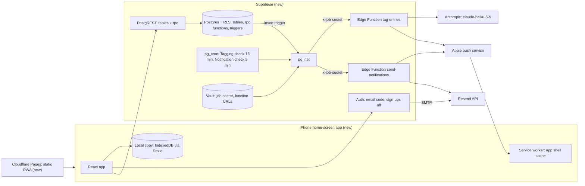
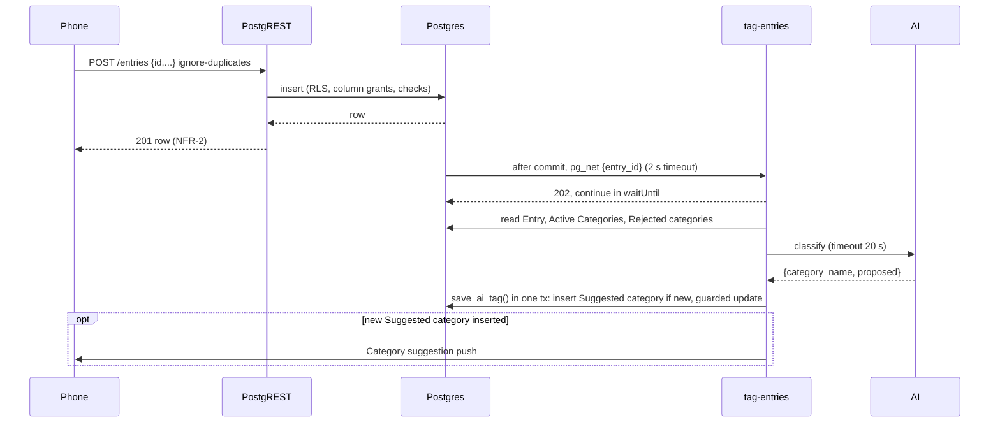
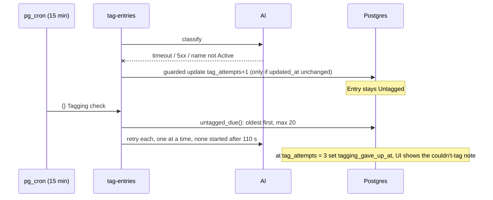
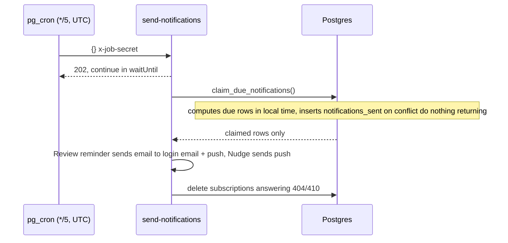

# daily-kaizen MVP: backend

Everything is new. Contracts are in [04-api.md](04-api.md), tables in [03-data-model.md](03-data-model.md). Decisions:
[ADR 0003](adr/0003-retry-untagged-entries-with-a-scheduled-check.md) (Tagging check),
[ADR 0004](adr/0004-require-a-connection-for-all-writes.md) (online writes, read-only Local copy),
[ADR 0005](adr/0005-use-database-functions-for-server-owned-writes-and-edge.md) (rpc functions; Edge Functions only for AI, push, email),
[ADR 0006](adr/0006-send-web-push-with-pushforge-builder.md) (push library).

## Components



## Key sequences

**Log an Entry and tag it (UC-1, UC-3)**



**Failure path: AI down or bad reply**



**Notification check (UC-5, AC-5.2, AC-6.1)**



## Modules and types

Repo layering is new; this follows Supabase defaults (`supabase/migrations`, `supabase/functions`) and keeps business rules in the database where ADR 0005 puts them.

| Module | Responsibility | Main types / interfaces | Depends on |
|---|---|---|---|
| `supabase/migrations/` | Tables, checks, indexes, RLS, grants, triggers (`updated_at`, clear the Tag on a text edit, insert → pg_net), phone rpcs from 04-api.md, internal job helpers `untagged_due()`, `save_ai_tag()`, `claim_due_notifications()`, cron schedules, `seed_account(uid)`, Vault secret + function URLs | Enums as in 03-data-model.md | Postgres, pg_net, pg_cron, Vault |
| `supabase/functions/_shared/` | Job-secret check, config check (503), service-role client, `sendPush()`, `sendEmail()` | `PushPayload`, `JobRequest` (implementation names) | `@pushforge/builder` (ADR 0006), Resend HTTP API |
| `supabase/functions/tag-entries/` | Build prompt, call AI, validate reply, call `save_ai_tag()` | `TagReply {category_name, proposed}` | `_shared`, Anthropic API |
| `supabase/functions/send-notifications/` | Call `claim_due_notifications()`, send claimed rows | `ClaimedNotification {kind, about}` | `_shared` |
| `app/src/data/` | Supabase client, writes with resend-on-unknown, Local copy refresh into Dexie, last ~50 save and refresh durations | `LocalCopy` | supabase-js, Dexie |

Job helpers are internal (not in 04-api.md): EXECUTE revoked from `public`, `anon`, `authenticated`, granted to `service_role` only. The insert trigger function is `security definer`, `search_path = ''`, owned by `postgres`, and wraps its body in an exception handler that raises a warning, so it never fails the insert. Time-zone rules live in `claim_due_notifications()`, testable without the Edge runtime.

## Concurrency model

- **Execution:** phone writes are sync requests. Tagging is a background job (trigger + 15-min cron). Notifications are a 5-min scheduled job.
- **Shared state and contention:** an Entry can be edited by me while `tag-entries` tags it; two `tag-entries` runs (trigger and cron) can tag the same Entry; approve can run while tagging inserts a Suggested category; two Notification checks can overlap if one runs long.
- **Consistency:** phone writes are strong (response shows the saved row). Tags are eventual: Untagged until tagging finishes (NFR-4, 30 min). The Local copy is a snapshot with `refreshed_at`.
- **Control:**
  - AI Tag: conditional update `where id = ? and tag_source is distinct from 'me' and updated_at = <read value>`; no match → roll back (data model).
  - Suggested category: unique case-insensitive name index; insert `on conflict do nothing`, so only the inserting run sends the Category suggestion.
  - Approve/reject: single rpc transaction, `select … for update` on the Category row.
  - Notifications: PK `(user_id, kind, about)` on `notifications_sent`; one SQL function computes and claims due rows (`about` formatted in SQL); the Edge Function sends only claimed rows.
  - Default isolation (read committed) is enough with the guards above.
- **Idempotency and dedupe:** phone keys as in 04-api.md Behaviour. Tagging is safe to repeat because of the guarded update. Notifications dedupe forever by PK.
- **Ordering:** none needed beyond `created_at` for overlap display. Tagging order doesn't matter.
- **Retries and timeouts:**
  - pg_net → Edge Function: 2 s default, no retry [S10]; losses covered by the Tagging check.
  - AI call: 20 s timeout (judgement), no in-call retry; Tagging check retries every 15 min, limit 3 attempts (≈ 45 min) then `tagging_gave_up_at`.
- Missing config (e.g. no `ANTHROPIC_API_KEY`): 503, not counted as an attempt.
  - Push send: 10 s timeout, no retry (R4).
  - Resend send: 10 s timeout, no retry; one email a week at most.
  - Phone → Server: 10 s, resend same request (04-api.md).
- **Backpressure and limits:** Tagging check takes at most 20 Entries per run, oldest first, one AI call at a time, and starts no new AI call after ~110 s (150 s wall clock [S11]); leftovers wait for the next run, so NFR-4 still holds at ~30 Entries/day. Both job functions reply 202 and finish in `EdgeRuntime.waitUntil` [S37]. pg_cron: 2 jobs, well under the 8-concurrent advice [S14].
- **Load model:** one user, ~30 Entries/day, ≤ 300 cron calls/day, ≤ 400 rows per refresh. First to break: Supabase free-plan pause (NFR-12), not load.

### Time-zone conversion

pg_cron runs in UTC [S43] (unverified; the design doesn't depend on it). Cron fires every 5 min in UTC; all local logic is in SQL with `now() at time zone settings.time_zone`, which handles DST. Rule:

```
local = now() AT TIME ZONE tz
Review reminder due  if local is Sunday and local.time >= 19:00
                     and no row (review_reminder, about = Monday of local week)
Nudge due            if a push_subscriptions row exists
                     and gap_start <= now() - 3 h (no Entries → no Gap → no Nudge)
                     and local.time not in Quiet hours (wrap-aware: start > end means [start,24h) ∪ [0,end))
                     and no row (nudge, about = gap_start)
```

Missing a run just delays to the next one (≤ 5 min, NFR-6). A Review reminder still not sent by Sunday 23:59 local is skipped (judgement, one simple rule). Nothing is due while `settings.time_zone` is null.

## Infrastructure

| Piece | Choice | Cost | Note |
|---|---|---|---|
| Database, auth, jobs, functions | Supabase Free: Postgres, PostgREST, Auth, pg_cron, pg_net, Vault, Edge Functions (Deno) | $0 | 500 MB DB, 500k invocations [S7]; ~9k invocations/month used |
| Static app | Cloudflare Pages, Free | $0 | `index.html` and `sw.js` served `no-cache`; hashed assets `immutable`, via `_headers`. Header behaviour on device: open question |
| Local copy | IndexedDB via Dexie, `navigator.storage.persist()` on each launch [S4, S23] | $0 | Disposable (G3 holds without it); confirmed by device test |
| Email | Resend Free (100/day) as Supabase SMTP and via HTTP API for the Review reminder [S13, S18] | $0 | Sending domain `mail.<my domain>`, set at setup |
| AI | Anthropic API, `claude-haiku-5-5` | < $1/month (judgement: ~900 short calls) | Price: open question |
| Push | Web Push to Apple, VAPID keys | $0 | `@pushforge/builder` (ADR 0006) |
| Secrets | Edge Function secrets: `ANTHROPIC_API_KEY`, `RESEND_API_KEY`, `VAPID_PRIVATE_KEY`, `JOB_SECRET`; Vault: `job_secret`, function URL | | NFR-11; VAPID public key is the only key in the app |
| Free-plan pause | Daily use is the mechanism; the pause warning email is the signal [S8]; a cron keep-alive write is an unverified extra | | Pause after a week without "sufficient user database activity" [S8] |
| Backup (NFR-5) | Weekly export (dashboard CSV or `pg_dump`) during the 14-day run | $0 | Free-plan backup availability unverified |

No new infrastructure beyond `docs/mvp-design.md`; the push library is ADR 0006.

**Sign-in code:** Supabase allows a resend once per 60 s and codes expire after 1 hour by default [S16]; custom SMTP starts at 30 emails/hour [S13]. "Send a new code" enables after 60 s.

**Session:** Supabase defaults: no session time limit on Free; access token 1 h, refresh token single-use with no expiry [S15]. supabase-js refreshes on open. Device test: a session survives 7+ days unopened.

## Failure modes

| Failure | Detection | Impact | Mitigation |
|---|---|---|---|
| AI slow or down | Timeout, 5xx; `tag_attempts` rises | Entries Untagged | Tagging check every 15 min; give up at 3; tag by hand |
| AI returns unknown name | Validation | Same | Counts as an attempt |
| pg_net call lost or Edge Function down | Untagged count; `net._http_response` | Tag delayed ≤ 15 min | Tagging check (ADR 0003); trigger never fails the insert |
| Config missing (kill switch) | 503 in `net._http_response` | Entries stay Untagged | 503 not counted as an attempt |
| pg_cron stops / project paused | `cron.job_run_details`; pause email [S8]; no `notifications_sent` on Sunday | No Nudge, reminder, retries; paused → app can't save | Daily use; restore from dashboard |
| Apple push down or subscription silently dead [S20, S21] | 404/410 only; otherwise invisible | Missed Nudge or suggestion | No retry; re-send subscription on every open; reminder also by email |
| Resend slow or down | Non-2xx, timeout | No reminder email, no sign-in code | Push still sent; code: retry after 60 s; row already recorded, so no duplicate |
| Supabase API slow or down | Phone timeout 10 s | Can't save (online-only, ADR 0004) | "Needs a connection", keep form, resend same request |
| Cloudflare Pages down | App fails to load first time | None once cached | Service worker serves cached shell + Local copy |
| iOS clears IndexedDB | Empty Local copy | Nothing lost | Rebuild on next refresh |
| Session revoked (refresh reuse) [S15] | 401 | Must sign in | Keep form, sign in (UC-6) |

## Observability

| Signal | Proves | Threshold |
|---|---|---|
| SQL view `nfr_report`: `created_at − form_opened_at` per create | NFR-1 | ≤ 15 s for 9 of 10 |
| Last ~50 save durations in Dexie, p95 shown in Settings | NFR-2 | p95 < 1 s |
| Last ~50 refresh durations, same | NFR-3 | ≤ 3 s |
| Date of last weekly export | NFR-5 | ≤ 7 days old |
| `nfr_report`: `tagged_at − created_at` for AI Tags never corrected | NFR-4 | 95% ≤ 30 min |
| Count of Entries with `tagging_gave_up_at` | Tagging failure | Any → look at function logs |
| `notifications_sent.sent_at` vs Sunday 19:00 local; Sunday row exists | NFR-6 | ≤ 5 min |
| Non-2xx and timeouts in `net._http_response`, checked daily | Job calls | Any |
| `notifications_sent` Nudges vs Gaps and Quiet hours | NFR-7 | ≤ 1 per Gap, 0 in Quiet hours |
| `cron.job_run_details` failures | Jobs running | Any failed run in a day |
| Edge Function logs (Supabase dashboard): AI, push, Resend errors | External failures | Inspect weekly |
| Supabase usage page, Anthropic and Resend dashboards | NFR-8, NFR-9 | < 50% of free limits; < $5 |
| Pause warning email [S8] | NFR-12 | Any |

No alerting service: one user reviews `nfr_report` weekly (judgement; fits the cost limit).

## Security and privacy

- **Spoofing:** sign-ups off, email code to my address only [S16]. Job endpoints check `x-job-secret` from Vault with a constant-time compare; JWT check off for them only.
- **Tampering:** RLS on every table, column grants block SO fields, `security definer` rpc with `search_path = ''` and explicit `auth.uid()` checks (04-api.md Auth). pgTAP asserts every `public` table has RLS on and job helpers are service-role only.
- **Disclosure:** the anon key and VAPID public key are the only keys in the app (NFR-11). Entry text goes to Anthropic only; Edge Function logs never print Entry text. Push payloads carry no Entry text except the Suggested category name.
- **Abuse:** Supabase auth rate limits [S12]; job endpoints reject without the secret; Tagging check capped at 20/run.
- **Data handling:** as 03-data-model.md Retention.

## Testing strategy

- **Database (pgTAP via `supabase test db`, fixtures via `seed_account(uid)`):** constraints and error keys (AC-1.2, AC-1.3); RLS, grants, job-helper EXECUTE per role (AC-7.2, NFR-11); Tag cleared on text edit (AC-3.2, AC-3.3); guarded AI update races (AC-3.2, AC-3.4); Suggested category and approve/reject (AC-4.1, AC-4.2, AC-4.3); `claim_due_notifications()` with fixed `now()` across zones, DST, Quiet hours wrapping midnight, no subscription, no Entries, settings changes, double claim (NFR-6, NFR-7, AC-5.2, AC-5.3, AC-6.1, AC-6.2, AC-6.3); insert trigger survives a pg_net error.
- **Edge Functions (Deno test, mocked AI/push/Resend):** reply validation, attempt counting, give-up at 3, 503 on missing config, 110 s budget, 404/410 deletes subscription, secret check.
- **Contract:** phone data layer against local Supabase (`supabase start`): create resend with same id, edit, delete twice, refresh (AC-2.1–2.4, incl. AC-2.3); sign-in with code and expired session (UC-6).
- **Device (iPhone, iOS 18.4+):** first push (ADR 0006), session after 7+ days, Local copy survives a week, offline open from cache, Pages headers.
- **Load:** none; the 14-day run checks NFRs through `nfr_report`.

## Rollout and rollback

1. Create Supabase project; set Resend SMTP with sending domain `mail.<my domain>` before the first sign-in [S13]; disable sign-ups; create my user.
2. Apply the migration (tables, policies, functions, Vault secret and function URLs), run `seed_account(uid)` once (`settings` and 5 Categories), then deploy Edge Functions and secrets, then enable cron schedules last. Order is safe: the trigger tolerates a missing function (the Tagging check catches up).
3. Deploy the app to Cloudflare Pages; add to Home Screen; device tests.
4. Start the 14-day run.

- **Kill switches:** `cron.unschedule` plus disabling the insert trigger stops jobs; removing `ANTHROPIC_API_KEY` makes tagging answer 503 without counting attempts (Entries stay Untagged, still saved).
- **Rollback:** app — Cloudflare Pages rollback to a previous deployment; functions — redeploy previous version; schema — greenfield, drop tables before the run; after the run starts, changes are additive only.
- **Halt:** any lost Entry (G3) or a pause (NFR-12).

## Open questions

- Session lifetime in the home-screen app (Supabase defaults): device test.
- Local copy store (Dexie + `persist()`) survives a week: device test.
- Free-plan backup availability: unverified; weekly export covers NFR-5.
- pg_cron runs in UTC: unverified [S43]; design doesn't depend on it.
- Current Haiku 5.5 price.
- Cloudflare Pages header and SPA fallback behaviour on device.

## Decisions

- [ADR 0006](adr/0006-send-web-push-with-pushforge-builder.md): send Web Push with `@pushforge/builder`.
- Sending domain `mail.<my domain>` (setup step); retry cap 3; pause handled by daily use plus warning email.

## ADR candidates

None beyond ADR 0006.
