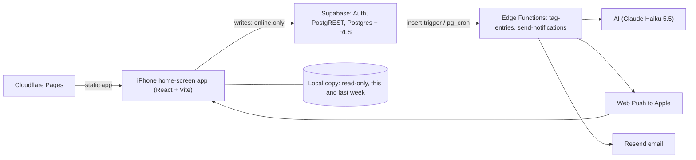

# daily-kaizen MVP: design

Status: approved · 2026-11-06 · Authors: Bach, Claude

## Context and scope

I want an honest picture of where my day goes. Screen trackers miss time away from devices, and the tools reviewed in the
README don't do AI tagging or a waste review ([00-brief.md](00-brief.md)). The MVP covers capture, AI tagging and a weekly
review, for one user on an iPhone (iOS 18.4+) home-screen web app. The repo has no code yet, so everything is new.

## Goals and non-goals

Goals (from the brief):
- G1 Over 14 consecutive days, log on at least 12 days and complete 2 Weekly reviews.
- G2 Logging an Entry takes under 15 s from opening the app, when online.
- G3 No saved Entry is ever lost: every write needs a connection, so a saved Entry is always on the Server ([D3](03-data-model.md#decisions)).

Non-goals: improvement experiments and AI suggestions (v1), screen or app tracking, other users, to-do lists, precise
timesheets, offline writing, running timers, Apple Shortcut logging, a native app.

## Overview

I log an Entry (text, start, end) on the phone; it saves only when the Server confirms. A database trigger asks the AI to
pick a Tag; a 15-minute Tagging check retries failures. A 5-minute Notification check sends Nudges and the Sunday Review
reminder. The phone keeps a read-only Local copy of this week and last week so the This week page and the form defaults
work offline. Business rules live in Postgres; Edge Functions only call the AI, Web Push and Resend
([D4](04-api.md#decisions)).

## Design

### Requirements → [02-requirements.md](02-requirements.md)

Seven user stories (US-1 to US-7) with 22 ACs: log and fix Entries (AC-1.x), online writes with a read-only Local copy
(AC-2.x), automatic tagging with retries (AC-3.x), Tag corrections and Suggested category decisions (AC-4.x), the This week
page, Review reminder and Review done (AC-5.x), Nudges and Quiet hours (AC-6.x), and sign-in with an emailed code (AC-7.x).
Key NFRs: save confirmation p95 < 1 s (NFR-2), 95% tagged within 30 min (NFR-4), 0 lost Entries (NFR-5), Review reminder
within 5 min of Sunday 19:00 (NFR-6), at most 1 Nudge per Gap and none in Quiet hours (NFR-7), under $5 a month (NFR-9).

### Data model → [03-data-model.md](03-data-model.md)

Six tables: `entries`, `categories` (status `active`, `suggested`, `rejected`), `push_subscriptions`, `settings`,
`weekly_reviews`, `notifications_sent`. The phone creates the Entry id when the form opens, so a resent create never makes a
duplicate. Server-owned fields (Tag, Tag source, `tagged_at`, Entry's Suggested category, tagging attempts) are never
written by the phone. A text edit clears an AI Tag so it is re-tagged; a Tag with Tag source me is never changed. The five
Starting Categories and their AI descriptions are fixed there.

### API → [04-api.md](04-api.md)

Supabase's generated API for plain row writes (create, edit, delete Entry; Review done; settings; Push subscription), guarded
by RLS and column grants. Postgres functions (`rpc/set_entry_tag`, `rpc/approve_category`, `rpc/reject_category`) for writes
that touch Server-owned fields. Every phone write returns the saved row and is safe to resend after an unknown result
(AC-2.2). The Local copy refresh is one read of this and last week.

### UI → [05-ui.md](05-ui.md)

Four screens: Log form (prefilled start and end, Recent chips, overlap note), This week (Category totals, Untagged, Unlogged,
Suggested category cards, inline Entry editing, Tag picker, Review done), Settings (push status, Quiet hours, Nudge gap) and Sign in
(email, 6-digit code). One `ConnectionBanner` shows offline and lost-session states; `SaveStatus` shows "saved" only after the
Server confirms. Storybook mockups of every screen are in `app/src/ui`.

### Backend → [06-backend.md](06-backend.md)

Two Edge Functions called by pg_net with a job secret: `tag-entries` (on insert and from the Tagging check; 20 s AI timeout,
give up after 3 attempts, then I tag by hand) and `send-notifications` (claims due rows in SQL, then sends). Races are
handled by a guarded update on the AI Tag, a unique Category name index and the `notifications_sent` key. Time-zone logic
runs in SQL from `settings.time_zone`. Web Push uses `@pushforge/builder` ([D5](06-backend.md#decisions)).
Rollout: Supabase project and Resend SMTP, migration and seed, functions, cron last, then the app and device tests.

## Alternatives considered

- **Web app with an Outbox for offline writes:** rejected in [D3](03-data-model.md#decisions). iOS storage can be evicted without trace and sync code is hand-written; online-only writes make G3 hold by construction, and missed time is backfilled.
- **RxDB or PowerSync** for sync: adds a library or service and a possible licence cost, for offline writing the MVP no longer needs ([D1](01-research.md#decisions)).
- **Native iPhone app:** breaks the budget and the agreed stack.
- **Apple Shortcut logging:** authentication and offline queuing unsolved; reconsidered only if logging is too slow.
- **Reuse TimeTagger:** no AI tagging or Weekly review; would mean working in another project's code.
- **Retrying tagging inside the call or with a queue:** a scheduled Tagging check is simpler and also catches lost trigger calls ([D2](02-requirements.md#decisions)).
- **All writes through Edge Functions:** an extra hop and more code than Postgres functions ([D4](04-api.md#decisions)).

## Cross-cutting concerns

- **Security:** sign-ups off, sign-in by emailed code to my address only; RLS on every table, column grants on Server-owned fields; job endpoints need a secret; AI, Resend and VAPID private keys only in Server secrets (NFR-11).
- **Privacy:** Entry text goes only to Anthropic; function logs and push payloads never include Entry text (except a Suggested category name).
- **Observability:** an `nfr_report` SQL view, cron and pg_net run tables, function logs and on-phone save and refresh timings, reviewed weekly by me; no alerting service ([06-backend.md#observability](06-backend.md#observability)).
- **Accessibility:** WCAG 2.2 AA contrast, 44 pt touch targets (NFR-10).
- **Cost:** all free plans plus the AI at under $1 a month (judgement); total under $5 (NFR-9).

## Risks and open questions

| Risk or question | Mitigation or default | Owner |
|---|---|---|
| Web Push fails on the device or Nudges silently stop | Test first push early; contingency: drop all push, Review reminder by email only | Bach (device test) |
| Supabase free-plan pause (NFR-12) | Daily use; pause warning email; weekly check | Bach |
| Logging still feels slow, so the habit fails (G1, G2) | Prefilled times and Recent chips; measure NFR-1 weekly in `nfr_report` | Bach |
| Online-only writes lose an Entry when there's no signal | Form text kept while the app stays open; backfill later (D3) | Bach |
| Free-plan backup unverified (NFR-5) | Weekly export during the run | Bach |
| Session lifetime in the home-screen app; Local copy survives a week; Cloudflare Pages headers on device | Device tests before the run | Bach (device test) |
| TBD: current Haiku 5.5 price | Check the pricing page at setup | Bach |
| UI defaults left open: Recent chip count, reminder email wording, Unlogged per day, no date picker | Keep defaults in [05-ui.md#open-questions](05-ui.md#open-questions) | Bach |

## Decisions

Each decision is recorded, with its options and consequences, in the stage doc where it was made.

| Id | Decision | Rejected options | Recorded in |
|---|---|---|---|
| D1 | Build the MVP as a home-screen web app on the agreed stack | RxDB, PowerSync, native app, Apple Shortcut, reuse TimeTagger | [01-research.md](01-research.md#decisions) |
| D2 | Retry Untagged entries with a 15-minute Tagging check | Rely on webhook delivery; queue table with backoff | [02-requirements.md](02-requirements.md#decisions) |
| D3 | Require a connection for every write; read-only Local copy | Outbox for new Entries; Outbox for edits and deletes too; Outbox for every write; fully online with no local copy | [03-data-model.md](03-data-model.md#decisions) |
| D4 | Postgres functions for Server-owned writes; Edge Functions only for outside calls | An Edge Function for every write; triggers only | [04-api.md](04-api.md#decisions) |
| D5 | Send Web Push with `@pushforge/builder` | `negrel/webpush` (fallback); npm `web-push` | [06-backend.md](06-backend.md#decisions) |
