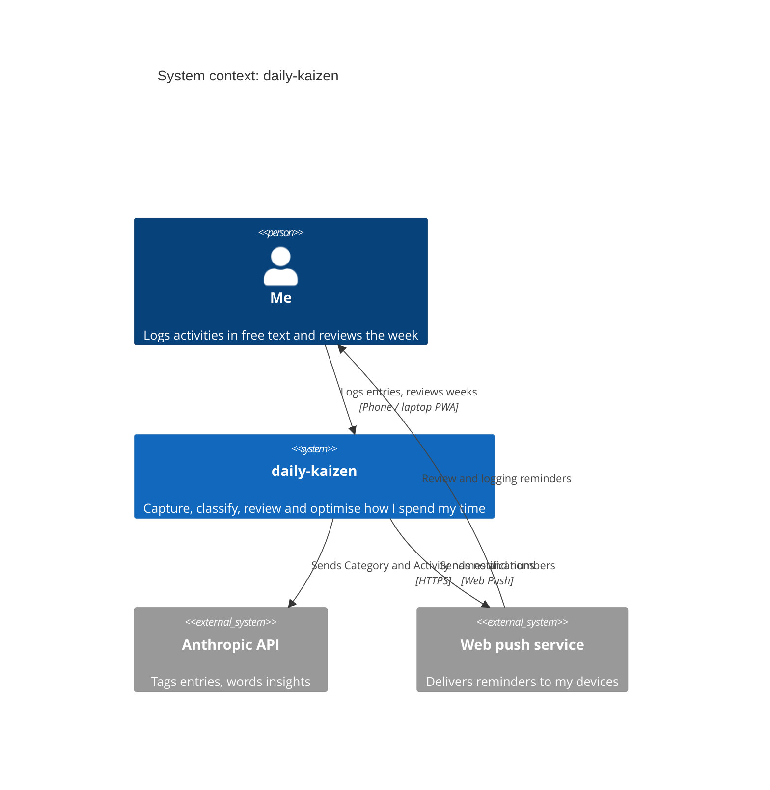
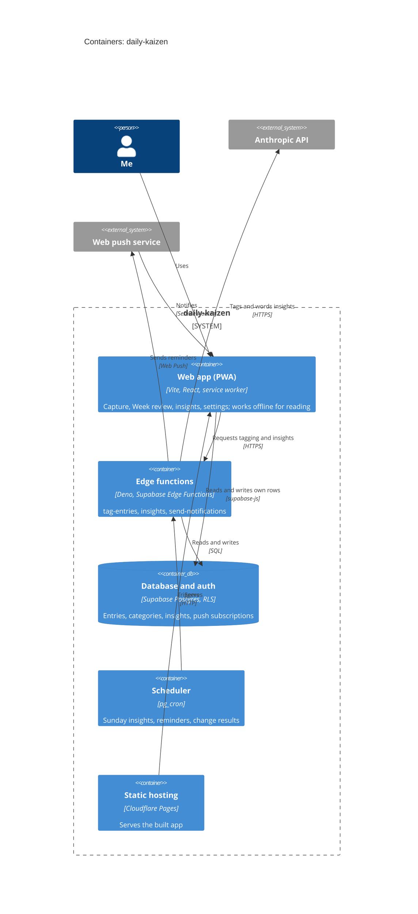
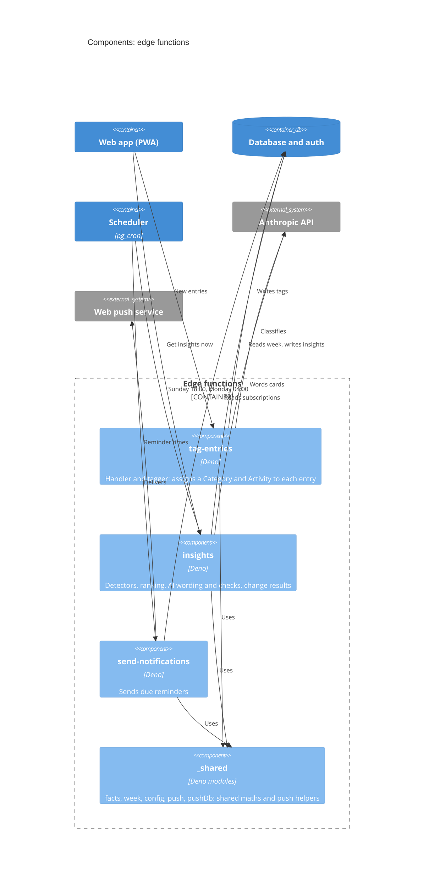

# Architecture (C4)

The top three levels of the [C4 model](https://c4model.com): system context, containers, components. Diagrams are Mermaid and render on GitHub.

## 1. System context

## 2. Containers

## 3. Components (edge functions)

