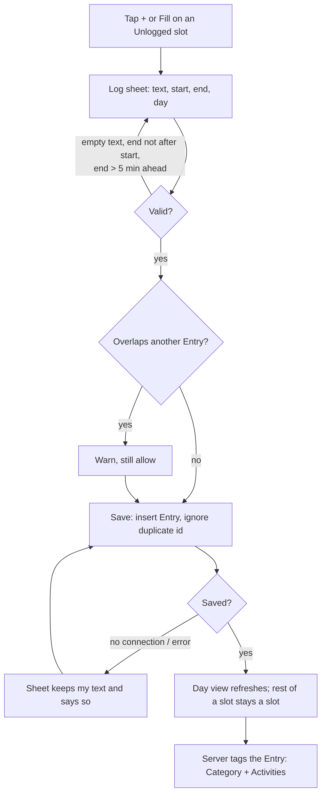
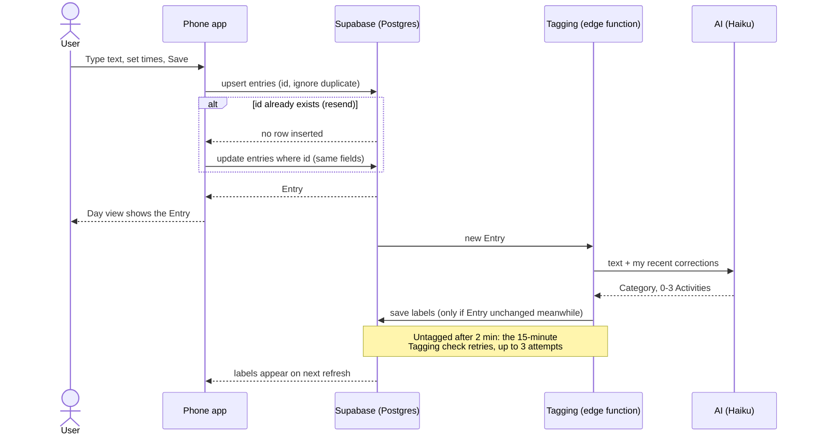
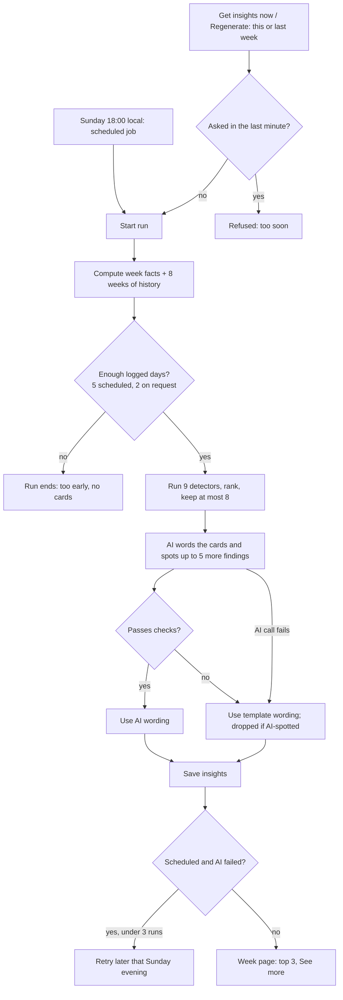
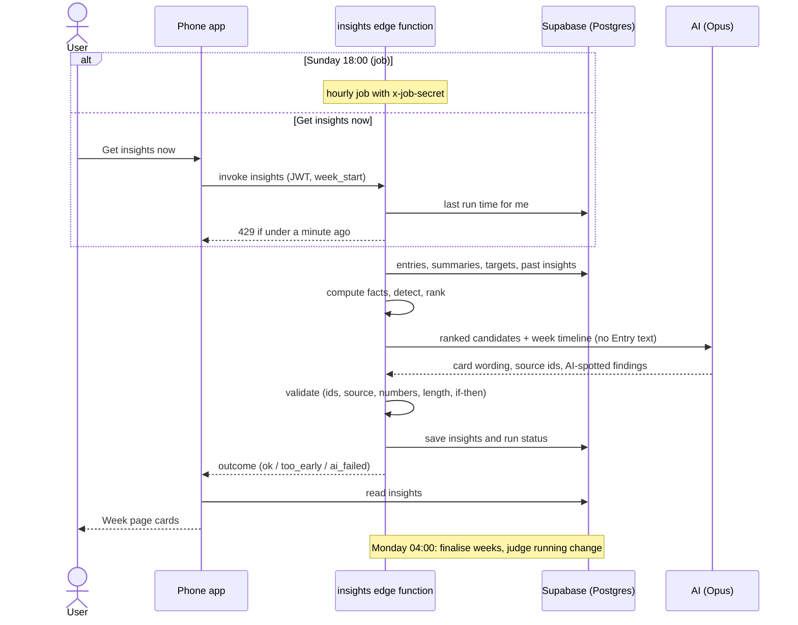
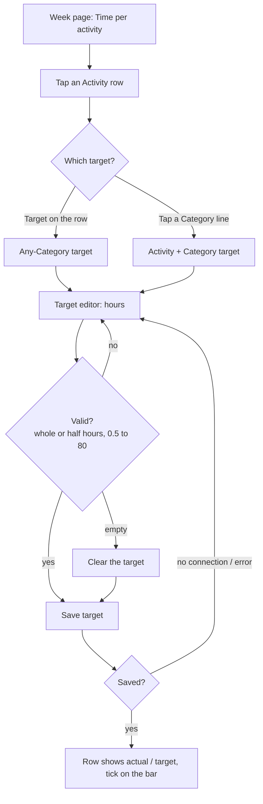
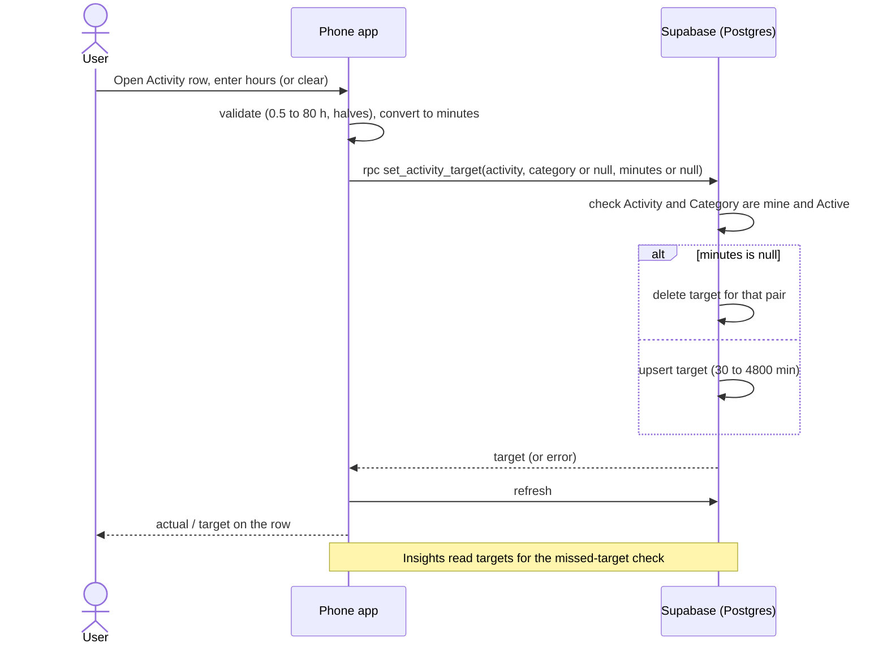

# Flows

Flow charts and sequence diagrams for three important user flows. Rules and decisions live in the feature docs linked under each flow; the code and tests hold the details.

## 1. Log time

See [logging](logging.md) and [tagging](tagging.md).

## 2. Generate insights

See [insights](insights.md).

## 3. Set an Activity's weekly target

See [week-review](week-review.md) and [activities](activities.md).

